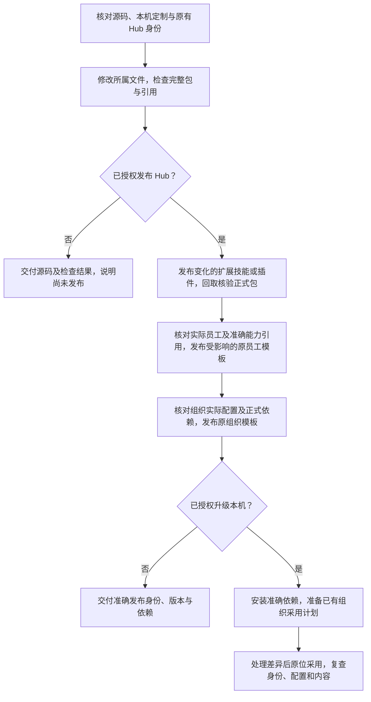

# 短剧组织：源码、协作与 Hub 维护

本页路径相对于本资源仓库。开发工具使用 `WORKBENCH_APP_ROOT` 指定应用项目，默认读取旁边的 `zero-point-workbench`。

本页供讨论、修改、发布和升级短剧组织时共同引用。专业方法以资源包正文为准，通用工具参数见[资源管理](https://github.com/huangjiaroro/zero-point-workbench/blob/v1.0.0/docs/resource-management.md)和[员工与组织广场](https://github.com/huangjiaroro/zero-point-workbench/blob/v1.0.0/docs/organization-gallery.md)。本页维护稳定的对应关系与操作原则，不保存逐次发布日志或最新版本表；实际版本从源码、所选 Hub 和本机采用记录分别核实。

## 先区分三种对象

| 对象 | 权威位置 | 修改或发布的含义 |
| --- | --- | --- |
| 源码定义 | `resources/packs/short-drama`、`resources/employees`、相应技能目录 | 开发中的内容；保存源码不等于发布或升级本机 |
| Hub 正式模板与能力包 | 明确来源、发布者、资源标识、正式版本及摘要 | 供他人下载安装；发布组织不自动发布员工或技能 |
| 本机实际组织与员工 | 工作台持久化配置、模板来源和采用记录 | 有独立实例 ID、定制、权限与历史；安装模板不等于已采用 |

下载的 `short-drama-bundle-vX.Y.Z.zip` 是源码交付集合。组织、员工、技能分别映射到现有源码，核对新增、修改、删除和相对链接；它不是上传一次就更新全部资源的 Hub 组织包。

使用 `pnpm bundle:pack --no-desktop` 从当前源码生成交付集合；构建先在临时目录校验组织、员工与技能，成功后替换 `dist/short-drama-bundle/` 并生成 ZIP。缺少源码依赖或结构不合法时停止并保留原目录，不沿用旧包内容。正式发布及已有实例更新使用下述宿主资源流程。

源码组织版本、员工定义版本、技能开发版本、Hub 正式版本各自管理。例如下载包的 `v5.2.3` 不能用作判断 Hub 组织是否最新的依据；正式版本由 Hub 分配。回取核验正式完整包后按[应用资源约定](../README.md)同步扩展源码，不只手改版本号。

## 资源身份：沿用原有发布关系

当前这套组织的发布者为 `huangjiaroro`，Hub 组织标识是 **`huangjiaroro-short-drama`**；源码组织标识为 **`short-drama`**。它们不是两个待分别发布的组织。

| 岗位 | 源码员工定义 | 原有 Hub 员工标识 |
| --- | --- | --- |
| 主创 | `project-lead` | `huangjiaroro-project-lead` |
| 编剧 | `screenwriter` | `huangjiaroro-screenwriter` |
| 创作研究员 | `creative-researcher` | `huangjiaroro-creative-researcher` |
| 质量审查员 | `quality-reviewer` | `huangjiaroro-quality-reviewer` |
| 视觉设计师 | `visual-designer` | `huangjiaroro-visual-designer` |
| 分镜导演 | `storyboard-director` | `huangjiaroro-storyboard-director` |
| AI 视频制作人 | `video-producer` | `huangjiaroro-video-producer` |
| 音乐制作人 | `music-producer` | `huangjiaroro-music-producer` |
| 后期制作人 | `post-producer` | `huangjiaroro-post-producer` |

这些对应关系属于本套已有资源，不是给其他资源自动添加作者前缀的算法。技能和插件按自身实际发布身份核对。

发布前从当前配置的 Hub 列出资源及全部分页，核对来源、发布者、标识、版本历史和本机来源记录。用猜测的标识查询得到 404，不能据此认定资源从未发布；同名卡片也不能证明同一资源。若已有资源的更新预览显示“首次发布”，先核对目标身份与历史匹配，避免创建平行模板。

本机原组织实例 ID 为 `499670ff-bb66-41fe-b389-091cbd0dc368`，只用于定位这台机器已有的组织，不进入分发包，其他用户也不使用这个实例 ID。本机 `sourceId` 同样不能作为跨机器身份；实际来源和信任信息从工作台读取，不在文档中保存令牌。

## 修改内容放在哪里

| 要修改的内容 | 源码入口 |
| --- | --- |
| 组织岗位组合、员工定义引用与插件清单 | [pack.yaml](../resources/packs/short-drama/pack.yaml) |
| 团队协作与交接 | [组织工作方法](../resources/packs/short-drama/playbook.md) |
| 各岗位在本组织中的职责 | `resources/packs/short-drama/{role}.md`，例如 [director.md](../resources/packs/short-drama/director.md) |
| 产物目录约定 | [artifacts.yaml](../resources/packs/short-drama/artifacts.yaml) |
| 员工通用身份、个人方法与默认技能清单 | `resources/employees/{定义标识}.yaml` 及其引用的 Markdown |
| 故事构思、创作与专业审核 | `drama-project`、`drama-writing`、`story-ideation`、`drama-review`（本组织实际安装清单以 `pack.yaml` 为准） |
| 导演四份成果设计、视频制作、后期 | `director-planning`、[video-shot-generation（含 Prompt 编译）](../resources/extensions/skills/video-shot-generation/SKILL.md)、[post-production](../resources/extensions/skills/post-production/SKILL.md) |

完整依赖以组织和员工定义为准，表格不是额外的安装清单。组织管分工与交接，员工管身份和个人工作方式，技能管专业方法；同一规则在所属位置维护，其他位置引用。修改前按[资源编写规范](https://github.com/huangjiaroro/zero-point-workbench/blob/v1.0.0/resources/builtin/skills/workbench-resource-authoring/SKILL.md)检查归属。

`artifacts.yaml` 是组织模板中的目录约定源码；执行时宿主将当前作品目录约定写入会话根目录的 `project-contract.yaml`。员工从该会话文件解析 `${WB_PROJECT_ROOT}/artifacts` 下的产物路径。

短剧组织模板引用员工定义，不重复配置岗位的技能清单。主创只安装本职的协调、记忆与共创方法；了解专业员工能力时先查询成员职责，必要时用 `get_organization_employee` 获取该员工的技能目录，并以返回的准确摘要和包内路径读取方法。查阅支持共创、派工和审阅，不改变专业执行归属，也不向主创安装被参考的技能。宿主工具负责读取资料，受限执行模式无需访问其他员工的会话目录。

员工定义被多个组织引用时，还要检查其他 `pack.yaml` 的准确版本引用，避免引用不存在的定义导致加载失败。只同步相关定义与必要引用，不因此升级其他实际组织。

## 日常讨论的共同理解

主创与用户共创、定方向和委派。编剧完成单集设计、正文与 State 后自检，导演完成画面规划后自检，随后均由主创直接验收并决定采用。有具体问题需要独立专业判断或用户要求复核时，主创再委派质量审查员。原作者负责返修，主创验收修订。完整方法以[组织 PLAYBOOK](../resources/packs/short-drama/playbook.md)为准。

工单与共同背景由[项目协作技能](https://github.com/huangjiaroro/zero-point-workbench/blob/v1.0.0/resources/builtin/skills/project-coordination/references/work-orders.md)维护必要上下文，具体专业方案交作者发展，保留用户决定与团队采用方案的真实来源。编剧的整体开发和单集阶段分别以 [drama-project](../resources/extensions/skills/drama-project/SKILL.md)、[drama-writing](../resources/extensions/skills/drama-writing/SKILL.md) 为准，导演总体、表演、镜头与 BGM 统一以 [director-planning](../resources/extensions/skills/director-planning/SKILL.md) 为准；各阶段默认先读取模块索引及所用方法的相关正文，已有准确且仍适用的方法依据按技能规则复用；不要求全包通读或逐场重读，阶段方法和设计深度不在工单复制。

| 成果 | 负责人和用途 |
| --- | --- |
| `project-design` | 编剧交付的整体故事设计，保留人物、因果、系列机制与重要取舍，供用户和相关员工查看，与整体故事成果一并交接 |
| `episode-design` | 编剧交付的单集戏剧设计，与正文和 State 一并交接；导演读取以理解人物意图、潜台词与场景目的，剧情事实以有效正文为准 |
| `episodes/EP{episode}/director/*.md` | 分镜导演交付的四份视听设计文件：整体导演方案、表演设计、镜头规划与背景音乐规划；导演切点在镜头规划内；画面规划自检后交主创验收，无需等待 BGM；局部返修只更新受影响内容 |
| `episodes/EP{episode}/production/production.md` | 视频制作人唯一写入成果：顶部记录导演文件版本溯源与已采用素材/关键帧索引，下部记录生成尝试、Prompt、参数、抽帧来源与后期声画待办 |
| `music-track` | 按需要承接 bgm-plan 的配乐意图，结合当前实际画面制作、试听并记录音乐版本；由后期按真实时序剪入和混音，不强制每 Shot 一首 |

Shot 是连续摄影镜头，素材 Clip ID 属于视频制作人。导演按叙事与表演需要决定镜头边界，制作人按实际模型能力安排技术生成并独立索引；技术执行不修改已审定的导演设计，需要改变时交回导演修订。

表演与素材兼容的相邻 Shot 优先合并生成，受组织制作长度和真实工具能力限制时再作技术拆分；具体长度要求见[技术视频分组与长度](../resources/packs/short-drama/playbook.md#技术视频分组与长度)。本组织出图优先员工原生能力，受限后使用获准插件，具体顺序见[制作插件选择](../resources/packs/short-drama/playbook.md#制作插件选择)。

本页只作沟通摘要，字段格式分别由 [导演 Shot 设计](../resources/extensions/skills/director-planning/assets/shot-plan-template.md)和[制作记录](../resources/extensions/skills/video-shot-generation/references/production/shot-execution.md)维护，不另建一套字段或审核阶段。

## 修改、发布与升级

先明确本次授权范围：“同步源码”“发布 Hub”“升级本机已有组织”是三个不同结果。用户已授权的步骤连续完成，回报时分别说明实际完成到哪一步。

各步只处理确实变化或准确依赖受到影响的资源，不为整包版本变化重复发布所有技能与员工。发布顺序沿依赖：技能／插件 → 员工 → 组织；正式快照从实际员工、实际组织读取，不能只改仓库就宣称发布了新内容。原有资源继续使用上表中的正式标识；内置保护拒绝时核对选错的身份或来源，不修改保护规则来放行。

发布使用已有 Hub 工具和持久作业，固定来源、账号、源指纹、准确依赖和稳定操作号。准备、上传、正式发布、回取核验分别核对；网络超时或结果未知时查询原作业，继续其核验与同步，不换操作号重新提交。具体参数以 [Hub 技能](https://github.com/huangjiaroro/zero-point-workbench/blob/v1.0.0/resources/builtin/skills/workbench-hub/SKILL.md)为准，临时脚本不是长期操作入口。

已有组织从组织广场选择“更新已有组织”，或使用 `prepare-adoption(kind: organization)` / `apply-adoption`。先安装目标模板及准确员工、技能、插件依赖，再读取完整差异计划。保留原组织、员工 ID、成员关系、名称、执行偏好、权限、连接、作品与历史；不以新建组织代替升级。缺失依赖先明确安装，本机定制冲突先整合；岗位或成员组合变化、共享员工等不满足当前采用条件时，按具体影响处理，不绕过校验。

技能和插件的全局当前版变化会影响其他引用者，采用前检查影响；模板安装本身不覆盖实际组织。发布成功也不等于所有用户的已有组织已升级。其他用户需要有相应采用能力的客户端，安装依赖并明确采用；客户端打包、发布与资源发布分别交付。

内置技能随应用交付：内容变化必须更新内置版本并走应用打包，不能用同一个不可变版本覆盖新内容，也不通过 Hub 同标识发布。只升级业务组织时，无需因此改动内置资源。

## 完成时核对与回报

- **源码**：列出实际改动，检查完整包、Markdown 链接、脚本入口和组织／员工引用；文档修改运行 `pnpm check:docs`，其他检查按实际变更选择。
- **Hub**：查询真实远端记录，报告来源、组织和员工标识、准确正式版本及依赖；回取完整包核对文件、摘要和执行标记。确认没有误建同名平行资源。
- **本机**：分别检查已安装版本、已采用版本与实际内容／定制；核对原身份、成员、设置及作品保留。`modified` 标志反映与模板有差异，需读取具体差异，不能直接当作损坏或覆盖理由。
- **验证边界**：源码检查、正式发布、本机采用、客户端构建、安装包升级和真实创作效果分别陈述。结构检查通过不能证明真实导演或生成质量。

误发平行资源时，先修复并核验原资源的发布与采用关系，再按用户授权撤回错误资源、取消其本机模板安装资格。保留审计、历史准确包和未知提交的恢复证据，不连带删除原组织或作品。

以后可直接这样提出维护任务：

> 按 `docs/short-drama.md` 维护原短剧组织。以本次指定源码为准，核对原 Hub 身份和实际差异，完成已授权的发布及本机原位升级，保留已有员工、组织、设置和作品；分别报告源码、Hub、本机结果及验证边界。
