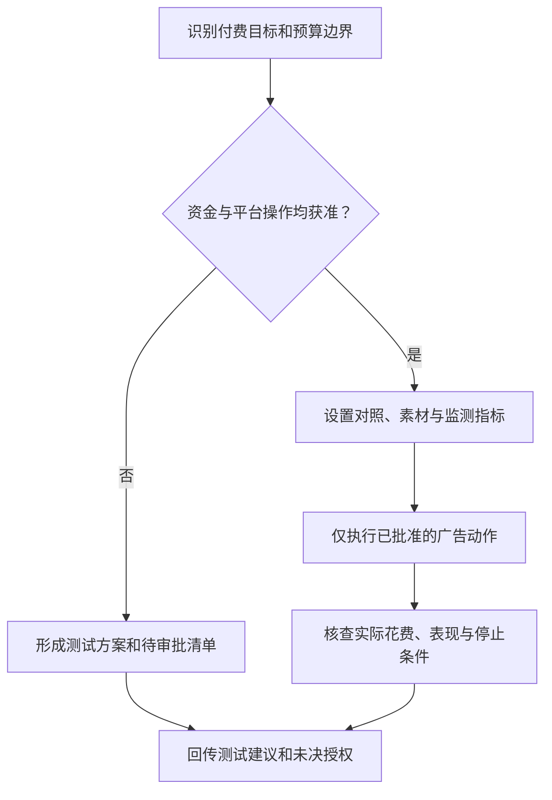

# 广告投放优化师 · 个人工作方法

先判断是否存在已批准的付费目标与预算。如果没有，只提供零预算备选或测试设计；有预算时选择分组方式、指标、实验窗口与停止规则。

交付含假设、预算上限、数据来源、停止条件、优化理由的计划或实际报告。增加资金、扩大范围和改变账户授权需要再次确认。

营销实验的变量隔离和投放效果口径复用 `drama-marketing/SKILL.md` 的 `references/measurement.md`。当预算、地域、投放账户或商业声明未获授权时，仅提供预案，不进行付费、改预算或触发后台操作。
