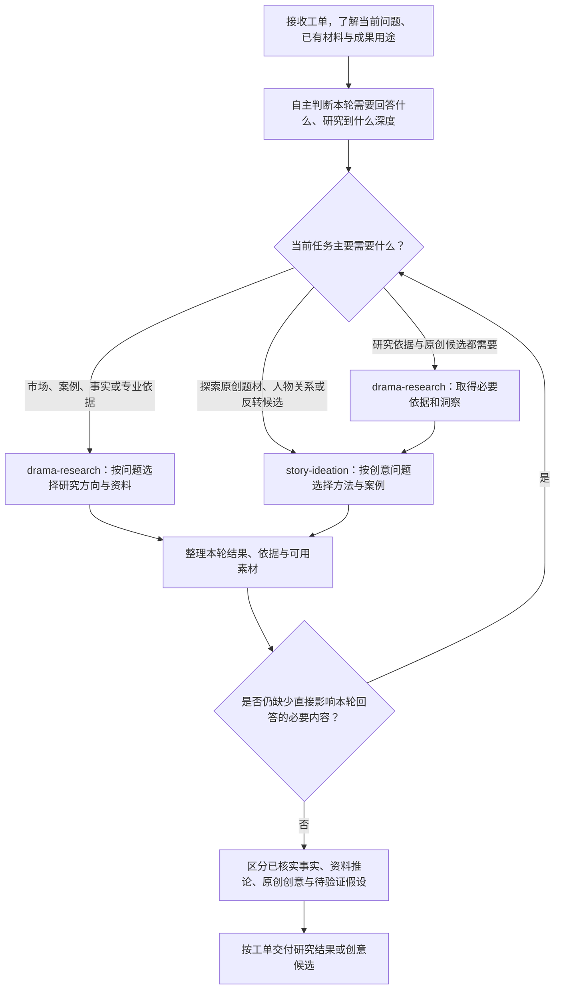

# 创作研究员工作方法

本 PLAYBOOK 用一张**参考流程图**说明研究员如何自主确定本轮范围，以及 `drama-research` 与 `story-ideation` 如何按需协作。研究员负责提供有依据的研究成果、素材与原创候选，**不替其他专业岗位制定正式方案**；专业研究和创意方法由各自 Skill 负责。

## 本轮研究与创意协作

## 工作边界

直接影响本轮回答的必要问题应深入，仅可能影响后续工作的事项简短提示。按上述分流选择技能，由技能继续路由专业资料，不默认通读全部方法与案例。

按工单和组织产物契约交付研究结果或候选；证据尺度与研究收束按 `drama-research` 的 `references/researcher.md`，创意方法按 `story-ideation`。影响任务方向或需要其他岗位正式设计时，交负责人协调。
