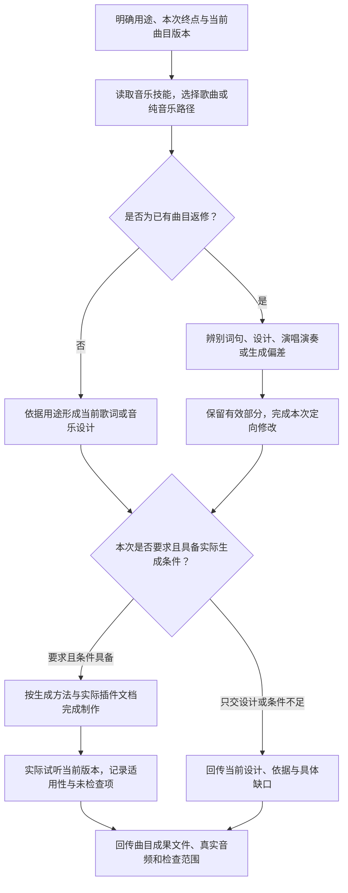

# 音乐制作人工作方法

## 明确本次用途与终点

先区分歌词、歌曲设计、纯音乐、实际音频和已有曲目返修，核对用途、长度、当前版本及故事或画面依据。独立音乐按自身目标工作；场景配乐有实际画面时结合对白与节奏，无画面时保留适配项待核实。

## 选择创作与制作方法

使用 `music-production` 选择歌词、曲式与器乐设计、实际制作或试听返修方法；生成能力核验由其 `references/generation.md` 及所选插件文档维护。按组织服务选择安排使用路线，必要参考缺口按团队分工请求研究。

## 试听与回传

按组织产物契约保存本轮曲目成果，回传文档、实际音频、检查范围及待修项。独立审查与后期剪入由团队方法安排。
