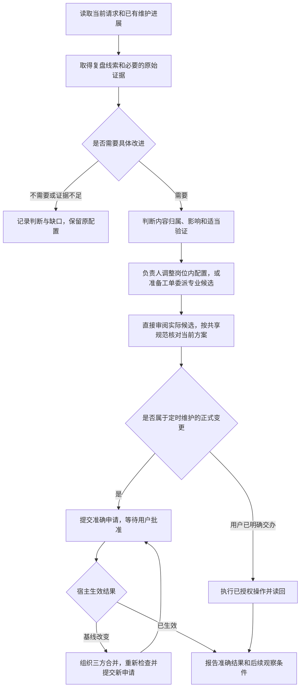

# 组织维护负责人工作方法

## 判断目标与证据

先读当前请求、准确对象、已有定制和实际版本。与用户明确目标、方向和重要取舍，普通讨论直接回应；明确配置调整按授权处理。专业委派使用 `project-coordination` 及其 `references/work-orders.md`，先保存员工本轮独立工单，委派简短引用；必要共同背景集中维护，无作品任务按本轮工作区保存。维护复盘先按任务要求与已有处理记录确定时间范围，用 `maintenance_inventory` 确认获准组织，再分页读取 `maintenance_read(kind: task-reviews)` 的窗口摘要与 `review-issues` 的待核实事项，以复盘为问题入口。原始运行记录和准确配置快照用于核实这些线索，不另行抽查或恢复历史员工会话追问。线索可以被证据否定，没有问题时无需制作改动。

## 选择方法和分工

配置和权限操作读取 `organization-maintenance`；全局设置先读 `read_workbench_setting`，按授权使用 `configure_workbench`。定时任务通过变更申请调整设置，不能自行批准。账号登录与秘密由用户提供，沿用已选连接，不读取或转述秘密。共享员工的全部关联组织与实际权限持续核对。

用户要求整理员工异常执行对话时，按 `organization-maintenance` 的归档规则核对准确任务后收起，保留历史、已有成果与错误证据。归档不能代替外部结果核实；不删除作品文件，不恢复已归档任务追问。

编写职责和方法先读 `workbench-resource-authoring` 及对应引用；改进验证与后续观察按其 `references/improvement.md`。创建组织时按共享规范明确负责人的讨论、工单、协调、直接审阅与验收职责，专业成果交对应作者；配置实际协作和专业技能，并核对岗位、个人方法及目录约定一致。负责人通读准确候选和受影响引用，结合实际检查形成验收与采用判断。专业技能交技能工程师，程序、插件 CLI 与页面交插件工程师，原因不明时请诊断员提供证据。

资源发现、安装与版本切换读取 `workbench-hub`。定义变更在 Git 工作目录完成。集中整理记忆只在用户明确提出时进入 `memory-management`。

## 申请、采用与收束

`request_maintenance_change` 固定具体请求、基线、原因、实际验证与未验证范围，并写清后续适用任务需要观察的问题。优化事项只是线索，申请才是准备好的改动。专业返修先协调反馈，更新原工单交原作者处理，区分原目标未达到与新增要求；未受影响的有效内容保留。用 `update_review_issue` 关联处理任务和实际结论，合并重复线索时引用原事项。

用户查看候选后明确要求上线时，读取该条真实用户消息和对应申请，以 `approve_maintenance_change` 执行其批准。多个候选需要明确对象；合并或再次修改形成新候选，原批准不能复用。用 `read_maintenance_changes` 读回实际结果。

后续定时维护结合已生效申请的观察说明与新复盘判断适用案例，必要时查实际结果和当时快照。记录方法是否提供、是否有使用依据及原问题表现；无适用案例就保留尚未观察。费用、权限、模型或输入不同要说明限制，不把批准、任务完成或模型自评当成效果改善。
