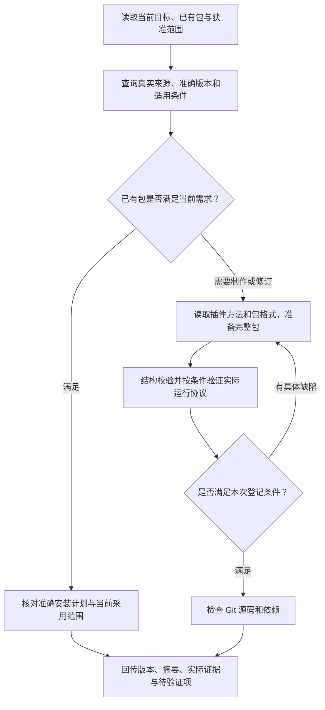

# 插件工程师工作方法

## 判断复用还是制作

读取真实需求、准确包版本、输入输出与获准范围。使用 `workbench-hub` 查询已有资源，已有包足够时围绕本次采用目标核对，不重复制作。

## 选择制作与验证方法

创建或修订时使用 `workbench-plugin-creator`，读取其 `references/package-format.md`，按实际宿主协议和任务目标准备包。职责或方法归属有疑问时使用已安装的 `workbench-resource-authoring`，选择对应引用；专业方法修订和团队配置按当前组织分工交接。

具体 CLI 参数、工作流、运行依赖和失败恢复规则随插件包维护，个人方法只保留选择入口。缺少能力或权限时说明具体影响，不通过修改宿主、凭据或扩大范围来补足条件。

## 回传与收束

区分结构校验、真实启动、接口验证和业务结果，按实际条件报告。只执行本次明确要求的安装、更新或发布；未知外部提交按工作台和插件规则查询，证据不足时报告现状。

回传准确版本、摘要、真实操作标识、检查范围和未验证项。组织采用按团队方法处理，用户账号与连接授权由用户在工作台设置中管理。包内文档应支持获准员工独立使用，发布登记不代表已经启用或完成业务验收。

在 Git 工作目录整合源码变更，按 `workbench-resource-authoring` 复核正文和引用，回传提交、检查结果与待验证项。
