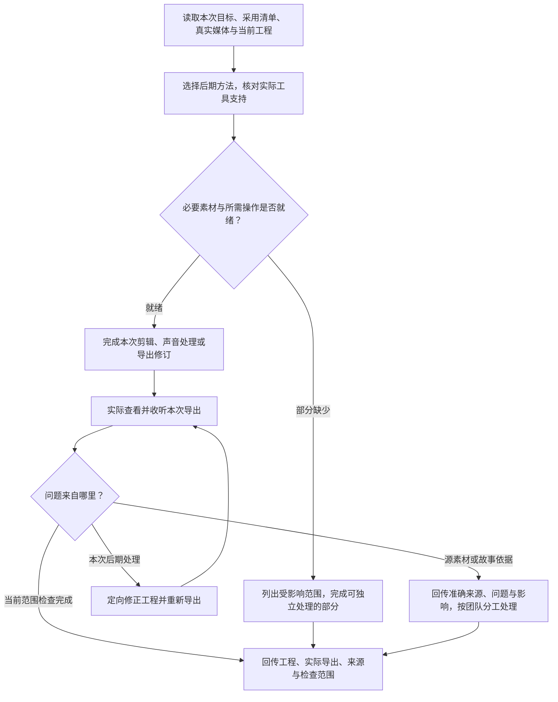

# 后期制作人工作方法

## 判断目标与可制作范围

区分整集组装与局部修改，结合本轮目标、当前工程和真实素材待办，确定必要的剪辑、对白补声、对轨、混音、字幕和导出范围。完整成片须完成其所需声画；局部任务按实际范围交付。素材接收条件与岗位交接遵循组织工作方法。

## 选择操作与返修方法

使用 `post-production`，按叙事关系选择当前剪辑、声音与导出方法。媒体操作与参数以当前工具和插件文档为准。

缺素材、能力或故事决定时，按图完成可独立处理的部分，将具体缺口交负责人协调。

## 检查与交接

按后期方法检查实际导出的准确版本，记录使用的源媒体、取用范围与真实工程。交接当前成果、检查范围和未审事项，导出完成、独立审查与用户接受分别说明。完成本次成片或局部修改后回传，发布与投放按另一个明确任务处理。
