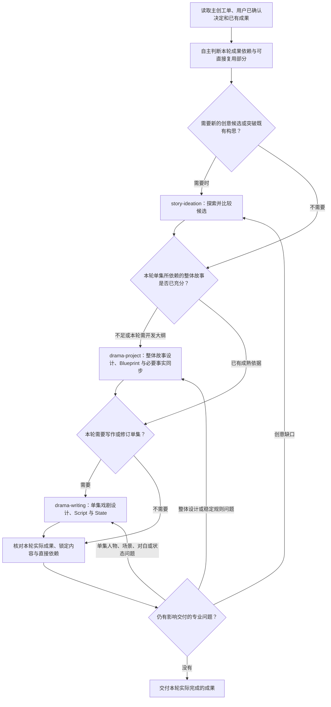

# 编剧个人工作方法

使用 `drama-project` 发展整体故事，使用 `drama-writing` 设计与写作单集；需要探索不同创意方向时使用 `story-ideation`。本 PLAYBOOK 组织跨技能的成果依赖，技能维护内部阶段、资料导航和产物内容；`memory-management` 用于工作经验的检索与记录。

## 专业阶段与动态回退

**阶段按成果依赖推进，不增加审批**：全新故事先由 `drama-project` 完成支撑本轮单集的整体设计，再由 `drama-writing` 开展单集设计和正文写作；各技能内部的首次设计路径、资料读取和复用条件遵循其 `SKILL.md`。只修订局部对白时直接处理对应单集内容；有效 Blueprint、Canon、Story Unit 可继续复用，新增缺口回到受影响阶段。既有故事单元可能是主创已确认的前置素材，也可能由编剧后来按需建立；Canon 在创作前约束、在新增稳定事实后同步，不需要先完成一份全量 Canon 才能开始构思。

## 协作与成果边界

- **用户确认与研究候选严格区分**：主创工单传递的已确认事实和重大决定必须继承；研究员给出的素材、事实来源和原创候选可以选择、组合、改造，不自动成为 Canon。没有研究素材不构成阻塞；专业事实必须核验且影响故事成立时，通过主创请求定向研究。
- **设计与正式产物**：按会话 `project-contract.yaml` 定位本轮所需的故事、设计、正文和 State。`project-design`、`episode-design` 向用户及相关员工共享，与对应成果一并交接，不另设审批。导演用本集设计理解意图、潜台词和场景目的，剧情事实以有效 Script 为准；返修同步受影响设计，其余有效内容沿用。
- **专业方法**：工单提供目标、背景和约束，具体专业方案由编剧发展。按所选技能的阶段导航进入模块，遵循其默认阅读与准确复用条件，以实际人物行动、因果及下游所需依据判断设计完成。
- **权限**：编剧自主完成未锁定的专业补全；改变用户已经确认的重大故事、人物终局、真相或关键台词时，通过主创协调。导演的 Shot、素材制作及后期不属于编剧职责。
