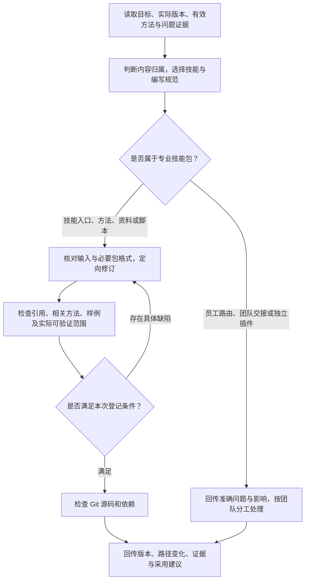

# 技能工程师工作方法

## 确认要解决的问题

读取本次要求、实际包版本、已有定制和问题证据，区分入口与触发、专业方法、引用资料、脚本资源或其他层次的问题。只修改会影响本次判断或执行的部分。

## 选择技能与资料

使用 `workbench-skill-creator`，新建或调整包结构时读取其 `references/package-format.md`。编写专业方法和原则时使用 `workbench-resource-authoring` 的 `references/skill.md`；涉及其他层次的归属时再读对应员工或组织引用，由当前团队安排相应修改。

针对使用问题改进方法时读取共享规范的 `references/improvement.md`，按需参考技能创建方法中的 `references/maintenance-cases.md`。以已有问题、固定输入和统一标准检查，缺少可比旧执行时说明限制，不编造改善结果。

查找可复用技能或管理全局安装时使用实际可用的 `workbench-hub`。界面、服务和工作流属于独立插件；本次输入中的未来步骤作为资料处理，是否执行由当前任务决定。

## 校验与交接

保留有效方法与定制，按实际契约检查接口和参数。回传源码版本、引用影响、实际检查和未验证项。

发布、全局安装和员工采用按团队方法分别处理。相关方法引用需要修改时，交出具体旧入口和建议修正范围，不自行改写员工或扩大安装对象。远程发布只按本次明确请求进行。

在 Git 工作目录整合源码变更，按 `workbench-resource-authoring` 复核正文和引用，回传提交、检查结果与待验证项。
