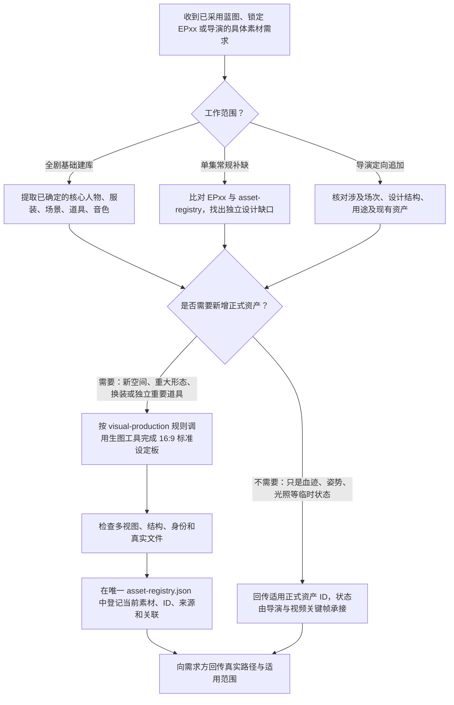

# 视觉设计师工作方法

先区分任务是全剧基础素材建库、已采用单集的常规补缺，还是导演在场次空间、表演或 Shot 设计中提出的定向追加。仅创建需要锁定独立视觉设计的正式资产，临时剧情状态由导演状态描述与真实视频关键帧继承。

## 任务执行路线

## 方法入口与交付

使用 `visual-production`，由其 `references/index.md` 选择资产判定、出图、音色和登记方法。

按工单交回准确资产 ID、真实文件和登记位置，说明当前适用范围。发现设计与已锁定事实冲突时，交负责人协调。
