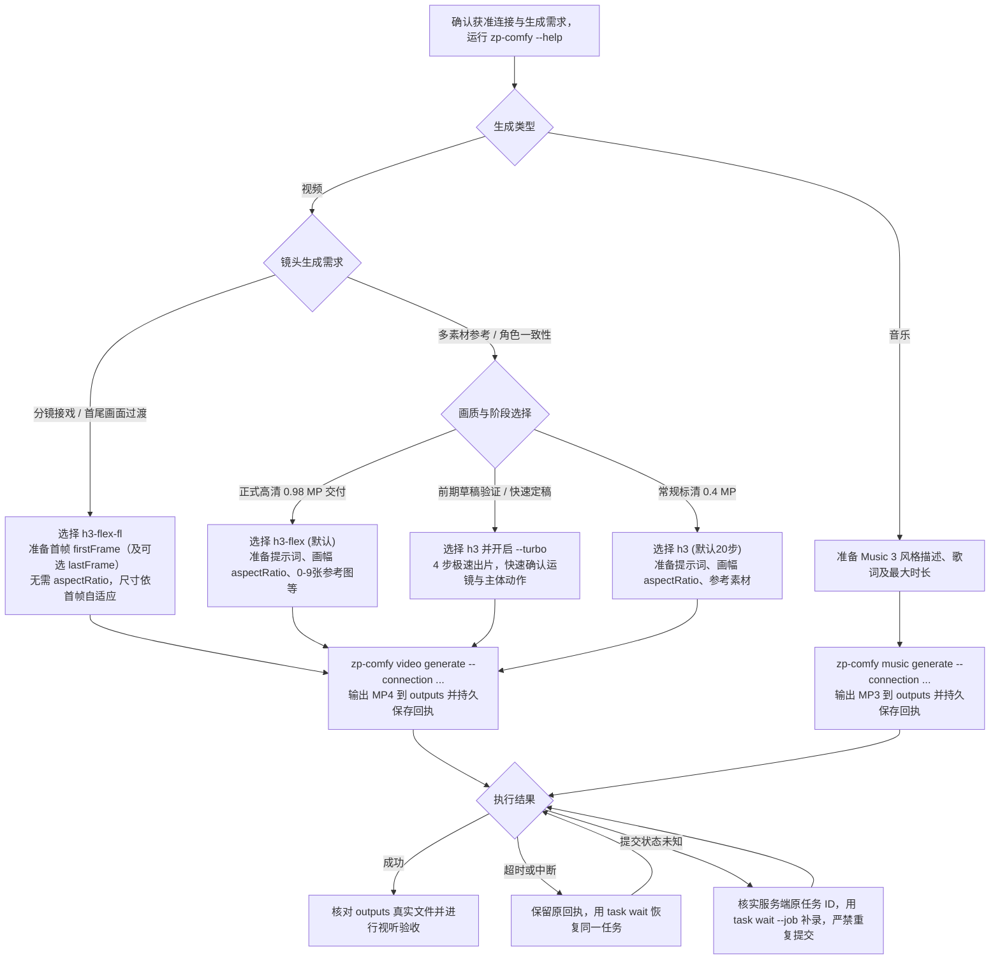

# ComfyUI 操作与恢复

组织需要通过 ComfyUI 生成视频或音乐、或恢复中断任务时使用。先读 [插件命令说明](../../WORKBENCH-TOOLS.md)，具体底层节点与参数细节见 [工作流资料](../../README.md)。镜头艺术构思与质量验收按当前任务的专业技能执行。

## 视频工作流选型指南

插件提供三种视频工作流，根据镜头目标与参考素材类型明确选择：

| 工作流 | 类型与模式 | 核心能力与输入约束 | 画幅与分辨率 | 适用场景与选型依据 |
|---|---|---|---|---|
| **`h3-flex`** *(默认推荐)* | 全能多模态参考 (ref2va) | 提示词 + **0–9 张参考图、0–1 个参考视频、0–3 个参考音频** 作为角色/道具/音色参考。 | 需指定 `aspectRatio`（16:9, 9:16, 1:1, 4:3, 3:4），**0.98 MP 高清**。 | **日常视频生成首选**。需要保持角色外观一致性、服饰道具特征，或结合音频/动态素材参考生成的高清镜头。 |
| **`h3`** *(标清保底)* | 全能多模态参考 (ref2va) | 同上（提示词 + 0–9 图、0–1 视频、0–3 音频）。 **可选 `--turbo`**（4 步蒸馏 LoRA 开关）。 | 需指定 `aspectRatio`，**0.4 MP 标清**。 | 显存/算力资源受限、服务端缺少 Flex LoRA，或前期需**快速验证定稿与运镜草稿**时选用（开启 `--turbo` 仅需 4 步即可极速出片）。 |
| **`h3-flex-fl`** *(首尾帧)* | 首尾帧定向过渡 (fl2va) | 提示词 + **必需 `firstFrame`（首帧图）** + **可选 `lastFrame`（尾帧图）**；**禁止**多参考素材。 | **无需且不支持 aspectRatio**，视频尺寸自动依首帧像素（取32倍数）对齐。 | **定点起止帧过渡首选**。两分镜之间需严密接戏、画面由状态 A 演进到状态 B、或由既有定格图精准起幅时选用。 |

> [!IMPORTANT]
> - 做角色一致性或多角度运镜，使用 `h3-flex`（或 `h3`），素材放入 `referenceImages`；
> - 前期快速验证分镜动作、低成本打样定稿时，优先选用 `h3` 搭配 `--turbo` 开关（4 步极速采样）；
> - 做前后关键帧过渡插值，必须使用 `h3-flex-fl`，传入 `--first-frame` 与可选 `--last-frame`，不要混用参考图与画幅参数。

## 选型与执行流程

## 执行规范与恢复

1. **参数与路径**：
   - 记录请求文件、所选连接路径与回执路径，严禁输出密钥内容。
   - 所有输入参数均可写入 work 下的 JSON 请求文件，或通过命令行直接参数传入（二选一，不得混用）。
2. **长视频与超时管理**：
   - H3 视频生成较耗时，应使用 `--timeout 0` 进行不限时等待，外层 Windows/宿主命令工具的 `timeoutSeconds` 亦设为 0。
   - 有限时等待返回 `pending` 并不代表远端失败，切勿重新发起新生成。
3. **回执与单进程锁**：
   - 生成命令在向 ComfyUI 提交前会持久化落盘 `.job.json` 回执并加排他锁 `.lock`。
   - 同一回执只能有一个活动进程执行。若使用 `--no-wait`，须等提交命令退出后再对原回执运行 `task wait --timeout 0`。
   - 提交中断或状态未知时，先在服务侧核验真实任务 ID，通过 `task wait --job <ID>` 补录，严禁新建回执或重新提交原任务。
4. **验收**：生成文件落地后，进行视听检查与成果归档。
