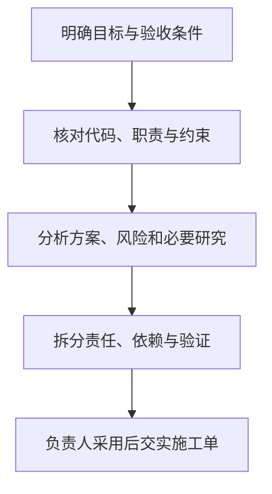

# Architecture Planning · 架构与计划

## 决策范围
读取真实仓库结构、现有接口、测试及项目约束后做最小改动决策，避免凭记忆猜测。区分用户想达到的结果、系统不变量、当前风险和可以延期的增强。

## 工作步骤

明确用户目标、验收示例、非目标、当前契约、需要用户判断的取舍。

按问题读取目标工程的说明、开发约定、依赖和构建配置、相关代码与已有设计记录，标出模块职责、调用方及数据的权威位置；先评估复用和最小扩展，再考虑重构。

涉及项目实际存在的权限、持久数据、长任务、外部调用或进程生命周期时，写清相关时序、状态转换、数据升级和异常恢复。按工程真实技术栈评估，不预设特定框架、数据库或运行平台。

形成 `方案/备选/风险/回退/测试策略`；必要时让技术研究员做一次可复核的外部技术调研。

把方案拆成明确输入、输出、依赖、验收条件和风险级别的小任务，涉及部署或数据变更时补充回退依据。每个任务指定责任员工；独立模块可以并行，没有界面或独立服务端时按工程实际分工。

在负责人正式采用方案后，交实施工单；方案变更必须回溯受影响任务，不能让开发者暗中改变公共接口。

## 完成定义
技术负责人审阅实际技术方案及最终代码/测试/集成的证据，验收设计契约与用户目标；**不重复做审查员的逐行 Git Diff 审查**。未跑测试只能称为方案完成，不能称功能已交付。

参考：obra/superpowers 的 writing-plans、dispatching-parallel-agents，按目标工程独立采用。
