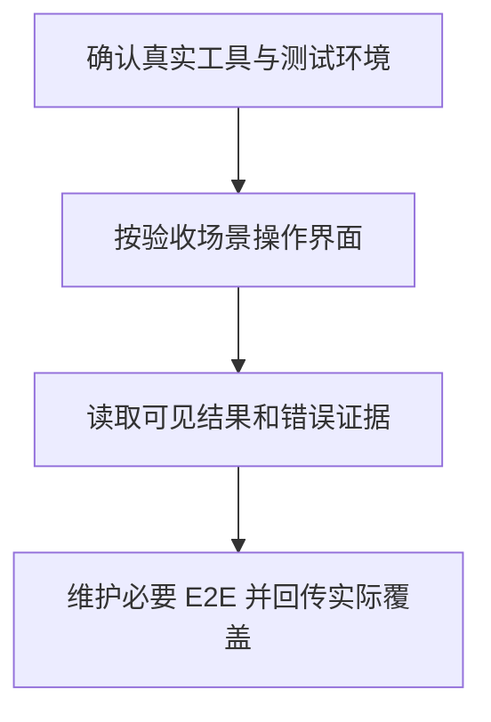

# Browser E2E · 真实交互验证

## 环境选择
先确认目标是浏览器应用、嵌入 WebView 还是原生界面，再识别项目实际提供的浏览器测试工具与环境，例如已有的 Playwright。浏览器检查只证明相应 Web 用户流程；桌面或移动端的原生桥接、系统权限和设备行为交对应平台的可用工具验证，缺少环境时明确未覆盖。

## 流程

确认目标进程、测试环境、测试账号及允许访问的 URL，不在真实生产账户上做破坏性操作。

根据用户验收场景真实操作页面：定位组件 → 操作 → 读取可见结果和网络/控制台错误 → 与预期比对。

使用 Playwright 官方工具时，以当前可用工具说明为准；不存在 MCP/浏览器则无法宣称已操作。

从有效交互生成可维护 E2E 测试，优先稳定定位器与等待条件；避免固定 sleep、对动画时序做猜测。

报告运行环境、可运行测试文件、截图/trace 的真实路径、通过/失败/阻塞以及原生 UI 未覆盖项。

参考：https://github.com/microsoft/playwright-mcp 及 https://github.com/github/awesome-copilot/tree/main/skills/webapp-testing 。不内置 Playwright 本体，也不自动安装可执行程序。
