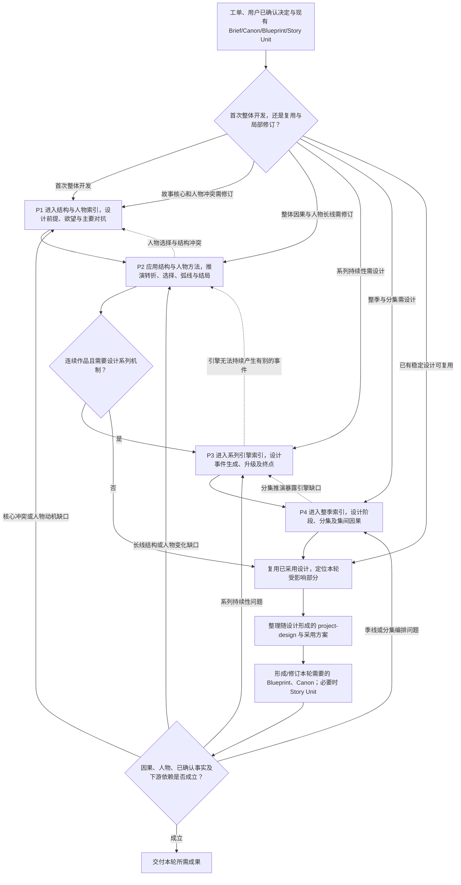

# 故事大纲创作（Drama Project）

本技能负责**整部故事的创作设计**，管理正式产物 `brief`、`project-design`、`blueprint`、`canon`；复杂案件、人物篇章或承重支线需要独立细化时按需管理 `story-unit`。真实路径由当前产物契约（`project-contract.yaml`）解析。`project-design` 保存可复用的设计推导与取舍，由编剧持续维护并向用户及相关员工共享，随整体故事成果一并交接，不增加独立审批。

## 一、已有依据与决策权限

- 从当前工单和已有成果中区分用户要求、授权范围内已采用的故事决定及候选建议。来源明确的用户决定与已采用成果在各自范围内生效，不必等重写 Canon；主创或编剧采用的方案仍按其实际来源记录，不改称用户确认。候选即使写得具体，也不能自动升级为锁定要求；来源不清时保留其待定性质，继续设计未锁定部分，影响用户保留决定的冲突交主创协调。
- **研究成果与候选创意不是用户确认决定**。研究员素材可引用、取舍、组合；缺少研究材料不阻塞编剧自行创作。确需事实核验时通过主创请求定向研究，不把所有构思交给研究员代写。
- 用户没规定的情节、人物、案件、类型细节属于编剧自主设计空间。需要跨越用户保留决策、推翻重要已确认真相或规则时，反馈主创协调。
- 现有成果已足以支持任务则直接复用；局部返修只处理受影响部分，不因新项目流程图而机械重做。

## 二、整体故事开发的成果依赖

首次整体开发从 P1 开始，P1/P2 共同发展人物与整体结构；连续作品继续完成 P3/P4，形成足以支撑本轮单集的故事依据后再进入单集创作。不必先写完全部单集。人物选择、引擎或分集推演暴露上游问题时，回到相应阶段调整；各阶段不单独审批。

局部修订从受影响阶段进入；已有成果已回答本阶段的问题且前提未变时，直接复用。工单中的人物、剧情节点和候选设定作为设计输入，尚未解决的问题由编剧发展。`project-design.md` 随设计保存关键推导与取舍，整理阶段汇总采用内容。

## 三、阶段内专业方法调度

按 P1–P4 的设计依赖进入对应 `index.md`，默认在设计前读取所采用方法的相关正文。相邻阶段的相关资料可合并读取，案例、专题和模板按问题选择，无需开工时通读全包。

本轮或当前上下文已读过准确内容、仍掌握方法及适用边界，或已有设计保留了准确且仍适用的方法依据时，可直接复用。包内特有规则、用户约束和产物契约使用当前准确内容；仅熟悉题材或理论名称不构成复用依据，不确定时先读资料。同一依据无需逐个人物重读。

将方法用于人物选择、因果和系列机制的实际设计，重要取舍写入设计稿；完成情况按本轮设计问题及下游所需依据判断，不另交阅读日志或逐阶段报告。

| 步骤 | 当前专业问题 | 资料入口及作用 | 成果归属 |
| --- | --- | --- | --- |
| **P1 故事核心与人物冲突** | 核心前提、主人公欲望、主要矛盾、行动代价是否能够驱动故事？ | [故事结构索引](references/story-structure/index.md)：前提、激励事件、因果机制；[人物与长期冲突索引](references/character-arc/index.md)：欲望、对手、不可回避的矛盾 | 整体故事设计稿／采用后的 Blueprint |
| **P2 整体结构与人物弧线** | 重大选择、转折、高潮、结局及人物变化如何互相成立？ | [故事结构索引](references/story-structure/index.md)：结构体系、转折、高潮、Truby 方法；[人物与长期冲突索引](references/character-arc/index.md)：压力升级、行动选择及弧线 | 整体故事设计稿／采用后的 Blueprint |
| **P3 系列引擎** | 如何持续产生不同而关联的冲突，什么时候升级或闭合？ | [系列故事引擎索引](references/series-engine/index.md)：事件模式、人物网络、持续冲突与失压诊断；人物根因可回查 P1/P2 | 连续作品的整体设计／Blueprint |
| **P4 整季与分集结构** | 整季阶段、主副线、单元与各集如何构成因果推进？ | [整季与分集结构索引](references/season-structure/index.md)：季形、信息管理、多线编织、悬念及案例；长线持续性可回查 P3 | 整季／单元／分集设计与必要 Story Unit |
| **PR/PW/PO 成果整理** | 已采用设计、事实来源、承重单元与正式大纲如何衔接？ | [项目维护](references/project-maintenance.md)：事实与定向返修；[设计稿说明](assets/project-design-guidance.md)、[Blueprint 标准](assets/blueprint-criteria.md)、[Brief/Canon/Story Unit 边界](assets/brief-canon-unit-guide.md) | 本轮需要的设计稿、Blueprint、Canon、Story Unit |

每个专业 `index.md` 描述所含理论、技法、案例和模板的适用问题；根据本轮具体设计任务选择资料，不把四个模块当作四张并列填写的表格。

### 辅助专业能力

- 创意方向需要候选或突破时，可调用已安装的独立 `story-ideation`；已有方向稳定时直接推进当前故事设计。
- 既有成果需要事实核对或局部修订时，使用[项目维护](references/project-maintenance.md)相应章节，区分已确认规则、未采用提议、角色认知与尚未发生的未来规划。

## 四、产物内容与边界

- [设计稿要求](assets/project-design-guidance.md)：保留各适用阶段的实际设计、因果与重要取舍，包括承重人物和对抗关系。首次整体开发保留设计稿供续写；局部任务更新受影响部分，已有明确设计可引用。内容深度以该指南为准，格式自由。
- [Blueprint 成果标准](assets/blueprint-criteria.md)：正式大纲应把已采用方案整理成可执行故事基础；不把内部分析原样复制，也不要求先写完所有单集才能启动相关单集。
- [Brief、Canon、Story Unit 内容边界](assets/brief-canon-unit-guide.md)：这三者**不设强制格式模板**。Brief 明确创作目标；Canon 维护稳定事实与用户锁定规则；Story Unit 按需展开某个案件/单元的因果设计，不等于单集剧本。

**阶段完成判据**：本轮需要解决的专业问题已在有效产物中得到具体解答，已确认决定不被推翻，并且足以支持直接依赖的单集设计。仅有文件、目录或标题不等于完成。

## 五、交付与回退

更新有关的 Blueprint、Canon 和 Story Unit 时，核对内容没有把研究候选当作已批准事实或把未来剧情当作已发生事件。后续 `drama-writing` 依据有效 Blueprint/Canon/Story Unit 开展单集创作；大纲中的新决定与既有锁定约束冲突时，先修复受影响的设计。`project-design.md` 可以帮助下游理解意图，但**正式已采用故事以 Blueprint、Canon 和有效剧本为准**。

