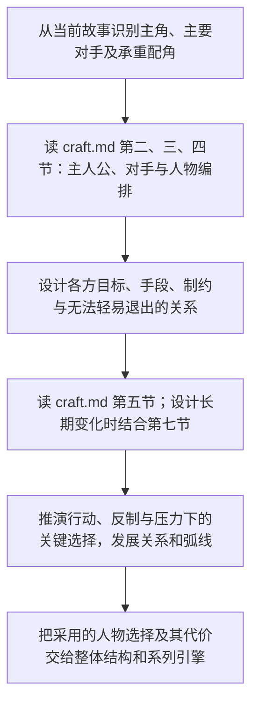

# 人物与长期冲突｜资料导航

## 模块说明

- **适用情境**：首次设计承重人物、对手关系与长期变化；修订欲望、动机或弧线；处理行动突然转向、冲突重复与选择不足。
- **专业原理**：人物通过压力下的选择、行动及变化被揭示。人物三维模型和心理学理论可以解释行为，但戏剧可信度仍取决于行动因果。
- **专业边界**：人物不必具有详尽的心理传记，也不一定正向成长；人物设计须与已确认的设定和世界规则一致。

## 当前人物设计的执行路径

用正文方法发展人物目标、对抗和压力下的选择，并将主角、对手及承重配角的变化共同用于结构推演。复杂动机选读心理学专题，转变缺少过程时选读冲突案例。

## 专业资料及用途

| 资料 | 主要内容 | 适用情境 |
| --- | --- | --- |
| [人物塑造与冲突技法](craft.md) | 主人公欲望、反对力量、对立统一、冲突类型与升级、心理动机、人物弧线、行动可信度诊断 | 从零设计重要人物；调整人物目标、对抗关系、关键选择或长期变化 |
| [人物模型与心理学](character-models-and-psychology.md) | 埃格里人物三维与人物研究清单、心理发展及人物变化的分析工具 | 深入解释人物的行为动因、矛盾来源与成长条件 |
| [人物冲突案例](examples/character-conflict-cases.md) | 静止/跳跃/升级型冲突的对照、人物编排、对手关系及戏剧案例 | 判断冲突推进是否自然，参考具体作品中的攻防和人物转变 |
| [埃格里剧本分析模板](templates/egri-play-analysis.md) | 可填写的剧本与人物分析项目 | 对既有剧本或复杂人物关系开展结构化分析 |

## 常见问题定位

| 创作或诊断问题 | 对应资料与章节 |
| --- | --- |
| 人物目标模糊，行为缺少动机 | [人物技法](craft.md)「一 人物是什么」「二 主人公」「八 诊断」；[人物模型](character-models-and-psychology.md)「一 埃格里清单」 |
| 对手弱、人物关系缺少不可回避的冲突 | [人物技法](craft.md)「三 对手」「四 对立统一」「五 冲突类型」；[冲突案例](examples/character-conflict-cases.md)「二 过渡阶梯」「五 对手要强」；跨集冲突见[系列引擎](../series-engine/index.md) |
| 态度反转或情绪爆发缺少渐进过程 | [人物技法](craft.md)「五 冲突运动」「七 弧光」「九 设计或修订路径」；[冲突升级正反例](examples/character-conflict-cases.md) |
| 人物心理自相矛盾，难以解释行动选择 | [人物技法](craft.md)「一 人物真相」「六 心理学工具」「八 诊断」；[人物模型与心理学](character-models-and-psychology.md) |
| 成长、堕落、循环或不变型弧线设计 | [人物技法](craft.md)「七 成长与弧光」「九 设计路径」；[人物模型](character-models-and-psychology.md)与[人物冲突案例](examples/character-conflict-cases.md) |
| 主角、对手、配角的功能与关系配置 | [人物技法](craft.md)「二 主人公」「三 对手」「四 人物编排」；[人物案例](examples/character-conflict-cases.md) |
| 对剧本进行埃格里式逐项分析 | [分析模板](templates/egri-play-analysis.md)；[人物技法](craft.md)「四、五」；[分析案例](examples/character-conflict-cases.md)「三」 |
