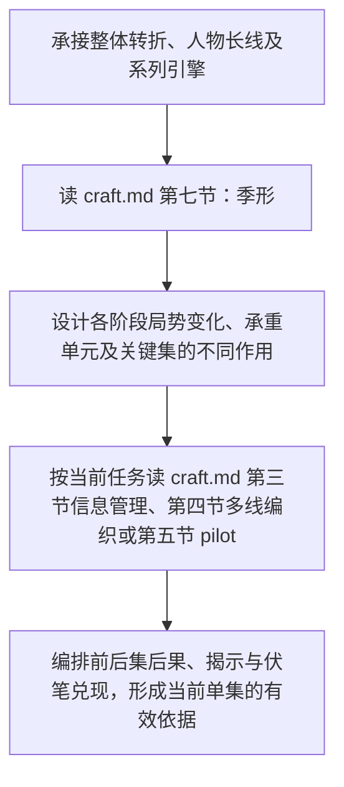

# 整季与分集结构｜资料导航

## 模块说明

- **适用情境**：首次设计整季阶段、单元与分集因果、信息释放和悬念；修订分集功能重复、季线脱节或多线安排失衡的问题。
- **专业原理**：分幕、节拍和信息管理服务于戏剧变化；不同媒介与剧集体例有不同的结构节奏。
- **专业边界**：广告分幕、固定页数、teaser 和 A/B/C 线属于特定创作体例；单集长度和集数以当前项目需求为准。

## 当前整季与分集设计的执行路径

依据适用正文和实际因果组织阶段与分集，案例用于比较当前结构选择。只开发部分单集时，先完成其所依赖的主线、信息状态和前后承接。

## 专业资料及用途

| 资料 | 主要内容 | 适用情境 |
| --- | --- | --- |
| [剧集结构技法](craft.md) | 单集容器、act out、cliffhanger、A/B/C/runner 编织、pilot 节拍、场结构、季形与结构诊断 | 整季分集安排、转折与悬念设计、多线因果组织 |
| [剧集结构参考表](episode-season-reference-tables.md) | 剧集类型、幕与节拍位置、信息管理、历史节目容器与行业样本 | 对照特定影视体例、校准术语和节奏参考值 |
| [分集与整季案例册](examples/episode-season-casebook.md) | 具体剧集的 teaser、出幕、多线编织、信息释放、Fleabag 季形与结构比较 | 研究分集推进、季终闭合及不同形式的实际运用 |

## 常见问题定位

| 创作或诊断问题 | 对应资料与章节 |
| --- | --- |
| 一季各集作用重复，缺少持续变化 | [剧集结构技法](craft.md)「七 季形」「四 A/B/C 编织」「九 诊断」；[整季案例](examples/episode-season-casebook.md)「九 季形」 |
| 多条人物线并行，但没有形成单集内的因果推进 | [剧集结构技法](craft.md)「四 A/B/C/runner 编织」；[案例册](examples/episode-season-casebook.md)「七 编织案例」 |
| 幕尾悬念薄弱、信息过早或过晚揭示 | [剧集结构技法](craft.md)「三 act out / cliffhanger」「六 场结构」；[参考表](episode-season-reference-tables.md)「六 信息管理」；[案例册](examples/episode-season-casebook.md)「五 出幕」 |
| 特定电视体例的 teaser、act 或页数安排 | [剧集结构技法](craft.md)「二 单集容器」；[参考表](episode-season-reference-tables.md)「一、二」；[案例册](examples/episode-season-casebook.md)「三、四」 |
| pilot 的节拍设计与系列机制展示 | [剧集结构技法](craft.md)「五 pilot 节拍表」；[参考表](episode-season-reference-tables.md)「一 pilot benchmarks」；持续剧集机制见[系列引擎模块](../series-engine/index.md) |
| 诊断已形成的季纲或分集卡 | [剧集结构技法](craft.md)「九 诊断」；[案例册](examples/episode-season-casebook.md)相关节目案例 |
| 半小时喜剧、国产 45 分钟剧等非美式广播体例 | [剧集结构技法](craft.md)「三、四、六」；半小时喜剧单集创作见 `drama-writing/references/comedy/index.md`；剧集类型研究见 `story-ideation` |
| 核对节目容器、页码或工业术语的历史数据 | [剧集结构参考表](episode-season-reference-tables.md)「十、十一、十二」 |
