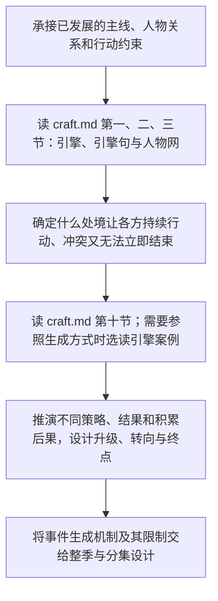

# 系列故事引擎｜资料导航

## 模块说明

- **适用情境**：首次建立连续作品的事件生成机制、人物关系网及升级终点；修订各集雷同、关系难以衍生新事件或长期对抗失压的问题。
- **专业原理**：持续叙事来自可变化的事件模式、人物关系与行动约束，连续剧情还需要真实积累的后果。
- **专业边界**：短季和限定剧可以拥有明确终点；系列开发的市场推介框架不是故事本身的必要结构。

## 当前引擎设计的执行路径

用引擎正文推演当前人物如何持续产生不同事件。主角已有压倒性优势时，明确对手的反制、优势边界及代价，并与既有规则和前期事件衔接。

## 专业资料及用途

| 资料 | 主要内容 | 适用情境 |
| --- | --- | --- |
| [系列引擎技法](craft.md) | 故事引擎、故事模式、人物关系网、pilot 类型、系列规划、改编与引擎诊断 | 建立或修订系列核心机制，处理重复和失压问题 |
| [系列引擎框架](series-engine-frameworks.md) | franchise、series type、arena、角色关系、pilot 分类等研究框架 | 比较系列类型、创作条件和持续冲突来源 |
| [系列引擎案例](examples/series-engine-cases.md) | 多部连续剧的引擎、事件模式与角色驱动方式 | 对照不同类型作品如何每集产生新的故事 |
| [持续冲突案例](examples/continuing-conflict-cases.md) | Mooresville 的人物地雷、关系与连续事件样例 | 群像关系、长期对手与事件连锁设计 |
| [系列类型与人物网络案例](examples/series-type-and-character-network-cases.md) | 系列 treatment、类型比较、人物网络、Succession 关系和引擎变化 | 判断系列规划深度、人物相互牵制及引擎的长期演化 |

## 常见问题定位

| 创作或诊断问题 | 对应资料与章节 |
| --- | --- |
| 故事想法能否支撑连续剧和多集变化 | [引擎技法](craft.md)「一 引擎定义」「二 引擎句」；[系列框架](series-engine-frameworks.md)「一、二」；[实际案例](examples/series-engine-cases.md) |
| 群像人物只会重复争吵，关系没有生成力 | [引擎技法](craft.md)「三 人物网」「九 诊断」；[持续冲突案例](examples/continuing-conflict-cases.md)；[人物网络案例](examples/series-type-and-character-network-cases.md)；人物自身动机见[人物模块](../character-arc/index.md) |
| 确定 series type、story pattern、arena 或叙事边界 | [系列框架](series-engine-frameworks.md)「三 series type」「六 人物网」；[系列类型案例](examples/series-type-and-character-network-cases.md) |
| pilot 如何呈现系列机制和角色世界 | [引擎技法](craft.md)「四 pilot 类型与策略」；[系列框架](series-engine-frameworks.md)「四 pilot 分类」；分集节拍见[整季结构](../season-structure/index.md) |
| 比较不同系列规划文档的内容与细度 | [系列类型与人物网络案例](examples/series-type-and-character-network-cases.md)「十二 Miller treatment 矩阵」；[引擎技法](craft.md)「六 系列规划」 |
| 原作改编能否延展为足够的集数 | [引擎技法](craft.md)「七 改编」「二 引擎句」「九 诊断」；[系列框架](series-engine-frameworks.md) |
| 长线重复、引擎失压或接近闭合终点 | [引擎技法](craft.md)「九 诊断」「十 按缺口发展」；[系列类型案例](examples/series-type-and-character-network-cases.md)「十三 Succession」；[持续冲突案例](examples/continuing-conflict-cases.md) |
