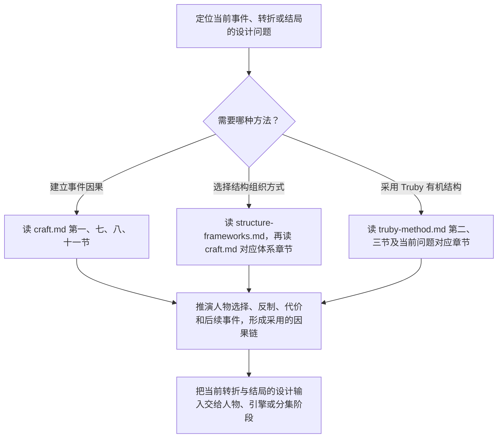

# 故事结构｜资料导航

## 模块说明

- **适用情境**：首次设计故事核心、整体因果、转折、高潮与结局；选择结构组织方式；修订因果或冲突升级缺乏说服力的已有蓝图。
- **专业原理**：三幕、BS2、九节拍、麦基叙事结构、陆军戏剧技法、Truby 有机结构等框架从不同角度解释事件和人物选择。
- **专业边界**：传统电影页码、卡片数量或教学节拍反映特定创作体例，微短剧的实际结构由故事的因果和戏剧需要决定。

## 当前结构设计的执行路径

按当前问题读取上述正文并发展结构。采用具名体系时使用其准确概念，例如 Truby 的需求、自我揭露与外在目标、得知秘密分别承担不同作用，具体定义与用法见专题正文。

## 专业资料及用途

| 资料 | 主要内容 | 适用情境 |
| --- | --- | --- |
| [故事结构技法](craft.md) | 结构层级、常见结构体系、激励事件、进展纠葛、危机、高潮、结局、非线性组织与结构诊断 | 整体故事构建、结构选择、因果与转折修订 |
| [结构体系对照](structure-frameworks.md) | 三幕、BS2、九节拍等体系的结构位置、概念和不同侧重点 | 对比结构模型，理解它们对同一故事的不同切分 |
| [故事机制与价值](story-mechanisms.md) | 情节机制、价值变化、悬疑/案件/游戏规则及事件因果分析 | 世界规则与情节机制相互制约、价值变化失衡等问题 |
| [Truby 有机结构方法](truby-method.md) | 设计原则、人物欲望与需要、七大关键步骤、22 步、人物四角对立与道德议题 | 由人物选择驱动情节、加强中段有机性和道德冲突 |
| [专业术语锚定表](craft-terms.md) | 创作体系原术语、译名、定义与资料定位 | 核对专业概念、版本差异和译法 |
| [结构案例](examples/structure-cases.md) | 影片与戏剧作品的结构拆解、节拍与因果实例 | 从完整作品中观察结构转折、高潮和伏笔回收 |
| [Truby 案例](examples/truby-cases.md) | 四角人物关系、22 步、道德选择与有机结构的作品案例 | 对照 Truby 方法在具体故事中的落地方式 |

## 常见问题定位

| 创作或诊断问题 | 对应资料与章节 |
| --- | --- |
| 只有故事方向，核心事件或因果链尚未成立 | [故事结构技法](craft.md)「一 结构层级」「七 激励事件与进展纠葛」「十一 设计路径」；[故事机制与价值](story-mechanisms.md) |
| 关键转折、高潮、结局靠巧合或缺少兑现 | [故事结构技法](craft.md)「七 激励与纠葛」「八 危机、高潮、结局」「十 诊断」；[完整结构案例](examples/structure-cases.md) |
| 选择三幕、BS2、九节拍、小戏等叙事方式 | [结构体系对照](structure-frameworks.md)；[故事结构技法](craft.md)「一至六」；[术语锚定表](craft-terms.md) |
| 中段松散、主人公选择与主题缺少联系 | [Truby 有机结构方法](truby-method.md)「二 设计原则」「三 七大关键步骤」「五 中段组件」「六 四角对立」「七 道德议题」；[Truby 案例](examples/truby-cases.md) |
| 悬疑、案件、游戏机制或世界规则前后矛盾 | [故事机制与价值](story-mechanisms.md)；[故事结构技法](craft.md)「七、八、十」；人物动机见[人物与冲突](../character-arc/index.md) |
| 非线性、多线与群像的结构难以成立 | [故事结构技法](craft.md)「一」「九」；[Truby 方法](truby-method.md)「二、九」 |
| 术语、译名或框架定义存在差异 | [专业术语锚定表](craft-terms.md)；[结构体系对照](structure-frameworks.md) |
