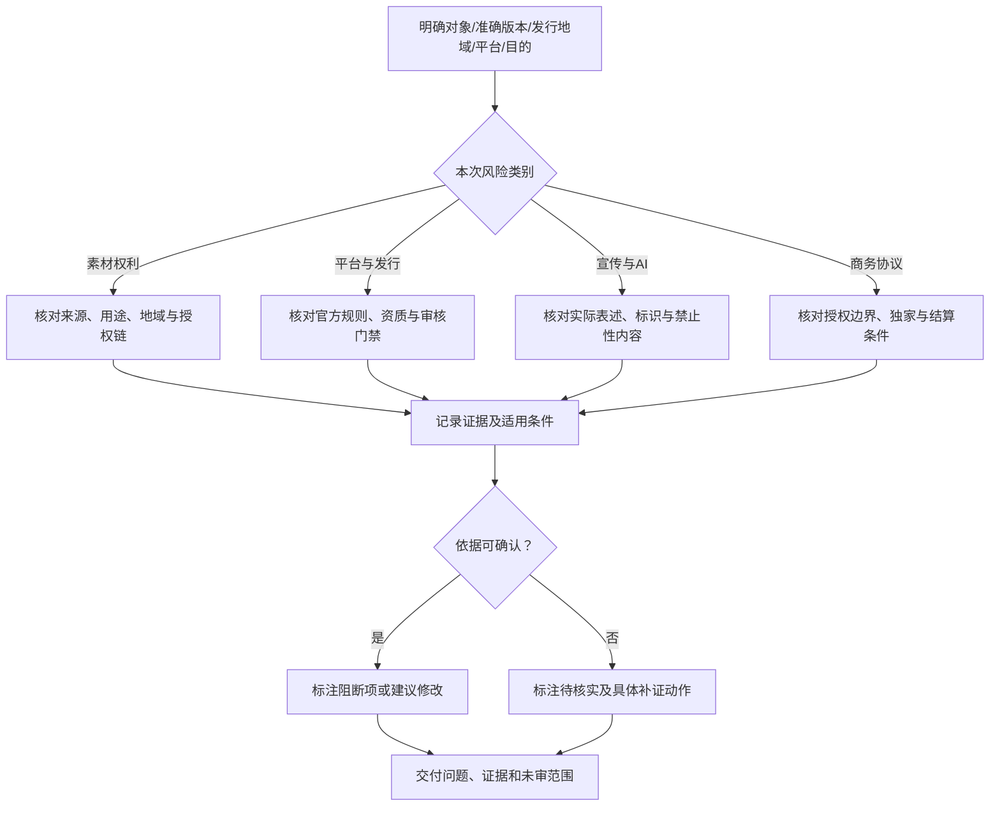

# 审查总方法：分范围、有证据、可定向返修

## 检查路径

对同时包含多类内容的成片/宣传活动可以逐项组合检查，不必机械跑全部材料。

## 输入必需项

审查对象（准确链接、文件版本、剪辑版本与 Hash 如可得）、发布平台/国家地区、账号和使用场景（正片/切片/付费广告/商务投稿）、用户已批准范围、可用授权凭证、官方规则来源与有效日期。

## 审查报告

| 字段       | 要求                                                 |
| ---------- | ---------------------------------------------------- |
| 对象与范围 | 逐项写出文件、版本、平台、地域和用途                 |
| 证据与来源 | 官方链接、原合同/许可证摘要、实际素材位置、核对日期  |
| 发现       | 具体问题位置，为什么会影响当前发布目的               |
| 等级       | 阻断 / 待核实 / 建议修改（不乱写总体 Pass）          |
| 责任建议   | 由原作者、发行商务、渠道运营或权利人补证/返修        |
| 限制       | 未审部分、资料缺失、规则可能变动及需要专业确认的疑点 |

审查不实际改动原作者成片或合同。返修后核对受影响的准确内容，保留原有已确认依据，不用新版本追溯改判旧任务快照。
