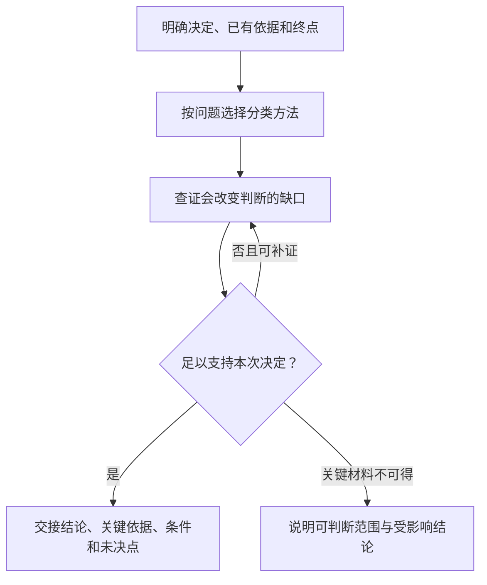

# 共同研究方法

先明确本次要支持的决定、已有材料和交付深度：探索可选方向、核查具体问题，还是为已授权设计补证。未确定的条件标明假设；会改变判断的缺口交主创取舍。已有且适用的依据直接复用。

## 证据与深度

外部事实按需联网，优先原始数据、官方资料和作品原文。搜索摘要与二手解读用于定位；关键判断追到足以支撑结论的原文，保留链接、版本或片段位置。区分事实、观察、推论与创作假设；无法查阅、观看或试听的范围如实说明。

依据充分或关键材料无法取得时收束。样本、来源和备选数量随问题确定；不为凑数扩搜，也不把局部核查扩成完整报告。精度以是否改变当前判断为准，具体尺度见分类方法。难以确定本次研究应做到什么程度时，参考[研究深度样例](research-cases.md)，结合工单确定范围。

## 交接

先给结论及其对本次决定的影响，再保留关键依据、适用条件、代价和未决问题。详证按需放在同一报告后部，不重复抄写来源、交接摘要或已确认材料。只有真实存在不同取舍时才给备选。

涉及实现适配度时，结合当前制作条件比较实现难点、风险及注意事项，说明已有依据、待验证条件；涉及成本时写清估算假设。研究用于支持取舍，具体拍摄、生成及后期方案由对应专业岗位制定。

研究回传不自动成为作品事实或执行约束；采用由主创或相应负责人决定，不把经验数值或未验证假设写成技术硬限制。不改蓝图、正文或状态，不执行媒体生成。需要实际试验时说明验证目标，由负责人按授权安排。
