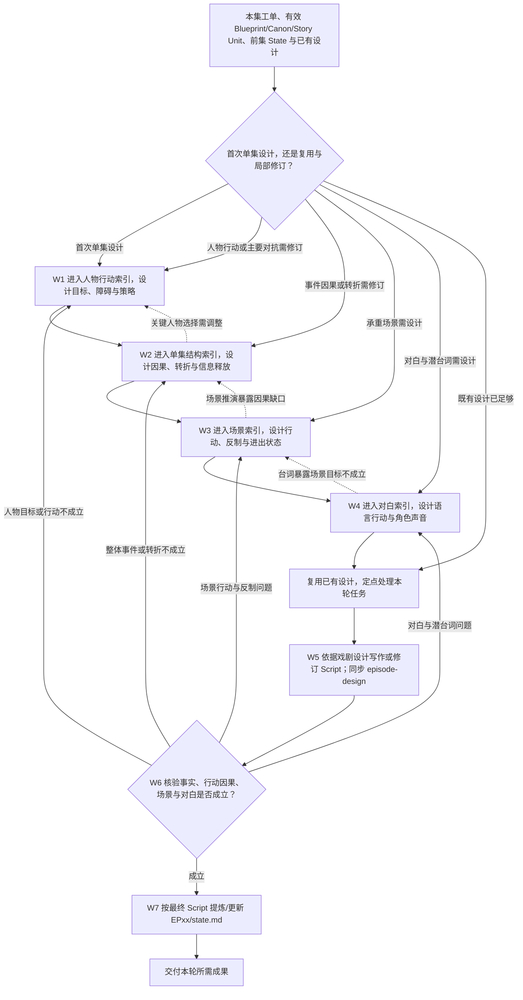

# 单集剧本创作（Drama Writing）

本技能负责**具体单集的戏剧设计、正式正文与续作状态**。组织正式产物为 `episode-design`、`episode` 和 `episode-state`，真实路径由当前产物契约（`project-contract.yaml`）解析。`episode-design` 随创作逐步形成并持续更新，向用户及相关员工共享，与正文及 State 一并交接，不增加独立审批。导演读取本集设计稿了解人物意图、潜台词与场景目的；真实剧情、对白和动作以有效 Script 为准。

## 一、输入与决策边界

读取本集实际相关的工单要求、Blueprint、Canon、Story Unit、前集有效 State 及必要正文。**用户已确认要求、授权范围内已采用的情节、名场面、真相和台词**不可为追求视频时长或新的创意而擅改；工单或设计中的候选建议保留其可取舍性质，采用后也不改称用户命令。编剧自主设计未锁定的具体行为、戏剧策略、对白、场景。研究素材只作为参考，缺失不阻塞正常写作；需要新构思时可按需调用共享的 `story-ideation`。

如果有成熟的本集戏剧设计，直接复用并处理需要修改的部分，不从头设计；如果上游依据确实不足以支持本集重大情节，可在权限内定向补足，涉及用户锁定决定时交主创协调。

## 二、单集创作的成果依赖

首次单集设计从 W1 开始，按 W1–W4 的成果依赖发展人物行动、事件结构、承重场景和对白，再在 W5 形成完整正文；这些设计可相互推演、动态回退。`episode-design.md` 随设计保存关键行动、因果和意图，正文成形时同步实际采用内容。

局部返修从受影响阶段进入；已有成果已解决本阶段的问题且前提未变时，直接复用。人物简介、情节节点和格式要求尚未回答的设计问题由编剧补足。各阶段不单独审批，共同维护一份单集设计稿；镜头和技术 Clip 由下游岗位设计。

## 三、阶段内专业方法调度

开始设计前读取[设计稿内容约定](assets/episode-design-guidance.md)，按 W1–W4 的设计依赖进入对应 `index.md`，读取适用的专业方法正文再开展设计。相邻阶段的相关资料可合并读取，案例、专题按问题选择，无需开工时通读全包。W5–W7 使用相应的正文格式、核验及状态指引。

本轮或当前上下文已读过准确内容、仍掌握方法及适用边界，或已有设计保留了准确且仍适用的方法依据时，可直接复用。包内特有规则、用户约束和产物契约使用当前准确内容；仅熟悉题材或理论名称不构成复用依据，不确定时先读资料。同一依据无需逐场重读。

将方法用于具体人物行动、场景攻防、事件因果和语言选择，必要取舍写入设计稿；完成情况按本轮设计问题及正文中的实际表现判断，不另交阅读日志或逐阶段报告。

| 步骤 | 当前专业问题 | 资料入口及作用 | 成果归属 |
| --- | --- | --- | --- |
| **W1 人物行动与冲突** | 本集谁想得到什么、用什么策略、谁反制、选择付出何种代价？ | [人物行动与冲突索引](references/character-action/index.md)：欲望、动机、行动选择、对手及冲突升级 | `episode-design.md`；正式 Script 的人物行动依据 |
| **W2 单集结构** | 当前冲突如何形成开场、事件因果、主要转折、信息揭示与结尾？ | [单集结构索引](references/episode-structure/index.md)：因果、节拍、信息分配、转折及分集结构案例 | `episode-design.md`；正式 Script 的事件组织依据 |
| **W3 场景设计** | 各承重场景的目标、障碍、具体反制与状态变化如何表演？ | [场景设计索引](references/scene-craft/index.md)：场景内部行动、策略、转折、空间与道具的戏剧用途 | `episode-design.md`；分场动作与转场 |
| **W4 对白与潜台词** | 人物说话试图达成什么、如何攻防、语言差异及潜台词怎样成立？ | [对白与潜台词索引](references/dialogue/index.md)：语言行动、角色声音、潜台词与对白案例；喜剧任务可结合[喜剧索引](references/comedy/index.md) | `episode-design.md` 的意图；正式 Script 的台词与表演 |
| **W5 正式正文** | 如何将已成立的事件和人物行动写成完整可演的单集？ | [正式剧本格式](assets/episode-script-format.md)是本组织原创单集正文的格式标准；[写作补充原则](references/writing-principles.md)供动作与表达问题参考 | `EPxx/script.md` |
| **W6 剧本核验与修订** | 哪个环节导致人物、因果、场景、对白或上游事实冲突？ | [单集返修](references/revision-guidance.md)、[连续性](references/continuity-guidance.md)，并返回对应 W1–W4 专业索引定位根因 | 修订受影响的设计与 Script |
| **W7 续作状态** | 本集实际发生了哪些需被后续集继承的事实与认知变化？ | [State 规范](assets/episode-state-guidance.md)、[连续性](references/continuity-guidance.md) | `EPxx/state.md` |

喜剧、荒诞与笑点问题由[喜剧专业索引](references/comedy/index.md)定位具体技法；构思出现根本分歧或需要新候选时，可调用独立 `story-ideation`。以上步骤都围绕同一份单集设计与正式正文，不按四个模块分别创建交付件。

## 四、设计稿、正文和状态要求

- [episode-design 内容指南](assets/episode-design-guidance.md)：落实四类必备设计结果与完成判据；按真实戏剧组织表达，不提前写两遍完整对白。正文承重调整后同步相关部分。
- [episode Script 正文规范](assets/episode-script-format.md)：写清完整场景、可表演的动作和对白、戏剧变化与结尾。人物动机、场景策略和潜台词用于**实际创作与表演依据**，不要在正文中加大段专业分析、导演机位或测试报告。
- [episode State 内容规范](assets/episode-state-guidance.md)：**从最终版 Script 得到本集结束状态快照**，只记录续集真正要继承的事实、人物认知/误信、关系、承重道具与未解因果；它不是剧本总结或计划中但未发生的事件。

续写或修订时参考 [连续性与上下文指引](references/continuity-guidance.md)；具体写作细节按需读 [写作补充原则](references/writing-principles.md)。同一任务已读且仍适用的资料无须反复读取。

**阶段完成判据**：按设计稿约定逐项核对 W1–W4 的实际设计结果，缺失或只有概括标签时回相应方法补足；正式 Script 完整、可演、符合上游已确认决定并实际体现戏剧推进；State 来源于最终 Script 并与其一致。

**资料导航**：各 `references/<module>/index.md` 描述对应专业问题、技法正文、原始理论、案例和模板的用途；已确认的有效工作依据可在本轮创作中继续沿用。
