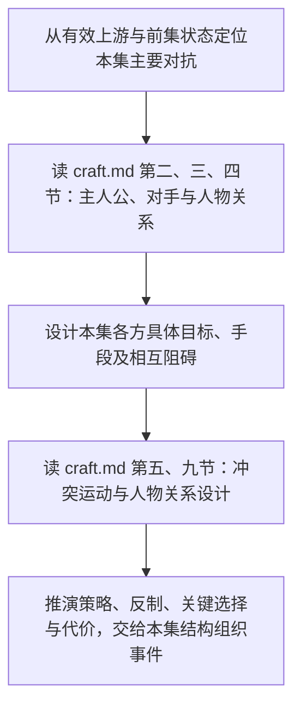

# 人物行动与冲突｜专业资料导航

## 适用、原理与操作路径

- **适用情境**：首次设计本集人物目标、策略、主要对抗和关键选择；修订动机不清、反制乏力或行动跳跃的问题。
- **专业原理**：人物通过压力下的选择、行动和变化被揭示，心理学是可选解释工具。
- **注意与边界**：无需默认编写长篇心理传记、硬套原型或让所有主角正向成长。

## 当前行动设计的执行路径

用正文方法发展本集行动，并将已有长期人物设计落实为当前知情、目标、策略和对手回应；心理学专题、冲突案例与分析模板按下表选择。

## 专业资料适用情境

| 创作问题 | 相关技法资料 | 对应理论、案例或工具 |
| --- | --- | --- |
| 人物为什么这么做、目标与行动不一致 | [craft.md](craft.md)「人物欲望、对抗与行动选择」 | [character-models-and-psychology.md](character-models-and-psychology.md)（需要心理学时） |
| 人物关系冲突无法升级、对手太弱 | [craft.md](craft.md)「对手设计与冲突升级」 | [conflict-and-opponent-cases.md](examples/conflict-and-opponent-cases.md) |
| 要用埃格里三维或严谨分析表核查角色 | [character-models-and-psychology.md](character-models-and-psychology.md) | [egri-play-analysis.md](templates/egri-play-analysis.md)（结构化分析工具） |

## 模块文件与用途

| 文件 | 用途 / 调用时机 |
| --- | --- |
| [craft.md](craft.md) | 本模块完整专业技法和原理；包含对应创作问题的完整论证与具体技法。 |
| [character-models-and-psychology.md](character-models-and-psychology.md) | 人物模型、心理学对照、角色工具，供动机和角色可信度诊断 |
| [conflict-and-opponent-cases.md](examples/conflict-and-opponent-cases.md) | 实际作品/分析范例 |
| [egri-play-analysis.md](templates/egri-play-analysis.md) | 填写时可复用的结构 |

## 使用边界

- 剧本、用户锁定事实及组织产物契约优先于历史教材中的页码、幕数、步骤、字数等标准。
- 索引定位适用技法、理论、案例及模板；正文承载专业知识，局部返修针对实际发生的问题。
- `examples/` 是实际作品与手法分析，`templates/` 是用于结构化整理的分析工具。
