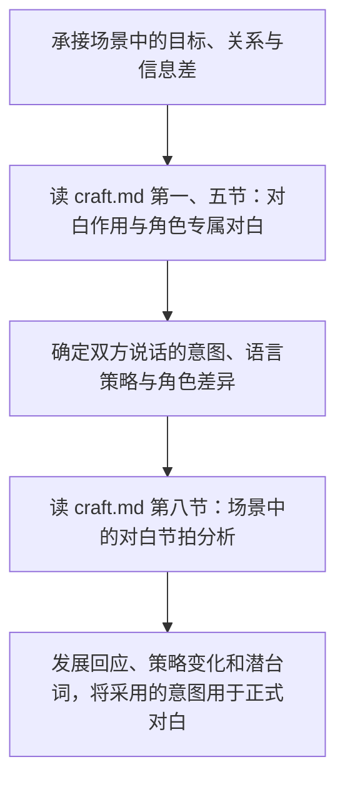

# 对白与潜台词｜专业资料导航

## 适用、原理与操作路径

- **适用情境**：首次设计本集对白行动、角色声音与关键交锋的潜台词；修订语言雷同、解释过多或缺少攻防的问题。
- **专业原理**：台词是人物实施行动的手段，其真意受到关系、目标与信息差影响。
- **注意与边界**：不是每句都要包袱或长篇潜台词分析，也不强制重做故事设计。

## 当前对白设计的执行路径

用正文方法发展语言交锋；解说负担、停顿与静默等问题按下表选读第二至四节，喜剧或戏曲迁移按场景需要选择。设计稿保留关键意图与行动关系，完整台词写入 Script。

## 专业资料适用情境

| 创作问题 | 相关技法资料 | 对应理论、案例或工具 |
| --- | --- | --- |
| 台词只是解释事实、缺少潜台词和攻防 | [craft.md](craft.md)「对白作为行动、隐藏意图」 | [dialogue-conflict-casebook.md](examples/dialogue-conflict-casebook.md) 对应冲突类型 |
| 人物声音雷同、台词不像这个人说的 | [craft.md](craft.md)「语言特征、角色身份、策略」 | [dialogue-conflict-casebook.md](examples/dialogue-conflict-casebook.md)「改写对照」 |
| 借鉴戏曲语言而非照搬唱词 | [craft.md](craft.md)「补充专业提示」 | 对照具体戏曲表达与角色语言问题 |

## 模块文件与用途

| 文件 | 用途 / 调用时机 |
| --- | --- |
| [craft.md](craft.md) | 本模块完整专业技法和原理；包含对应创作问题的完整论证与具体技法。 |
| [dialogue-conflict-casebook.md](examples/dialogue-conflict-casebook.md) | 实际作品/分析范例 |

## 使用边界

- 剧本、用户锁定事实及组织产物契约优先于历史教材中的页码、幕数、步骤、字数等标准。
- 索引定位适用技法、理论、案例及模板；正文承载专业知识，局部返修针对实际发生的问题。
- `examples/` 是实际作品与手法分析，`templates/` 是用于结构化整理的分析工具。
