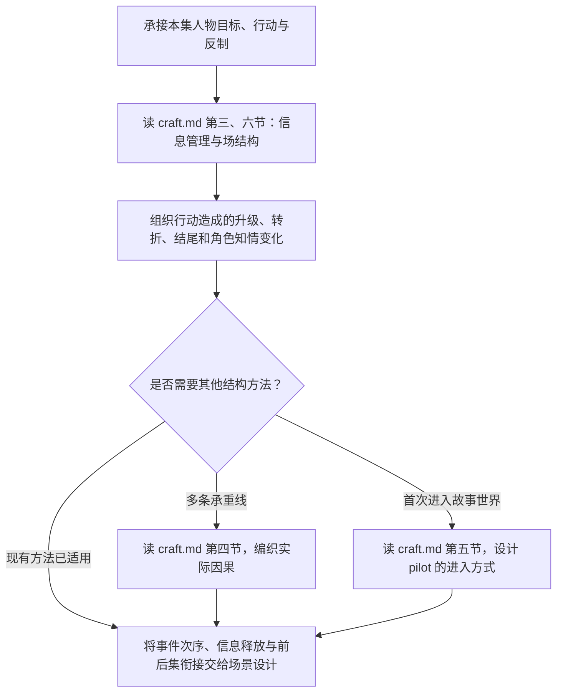

# 单集结构｜专业资料导航

## 适用、原理与操作路径

- **适用情境**：首次组织单集事件、转折、信息揭示和结尾；修订起承变化、多线编织或悬念衔接的问题。
- **专业原理**：幕与节拍反映戏剧变化；美式广播页码只是特定工业范式。
- **注意与边界**：不强制 teaser+四幕、广告断点、页数、固定格子或交付十四步。

## 当前单集结构的执行路径

按当前结构问题读取正文，发展事件之间的原因、选择与后果。确有平台体例需要时，再读第二节及参考表；多线与 pilot 方法可结合使用。

## 专业资料适用情境

| 创作问题 | 相关技法资料 | 对应理论、案例或工具 |
| --- | --- | --- |
| 本集结构松散、转折不足或结尾无推动 | [craft.md](craft.md)「单集戏剧变化、推进、结构」 | [episode-structure-tables-and-cases.md](episode-structure-tables-and-cases.md)「pilot / teaser / act out」按媒介匹配选择 |
| 信息揭示、悬念或 A/B/C 线错位 | [craft.md](craft.md)「信息释放、线索、分集结构」 | [episode-structure-tables-and-cases.md](episode-structure-tables-and-cases.md)「信息工具、A/B/C 编织」 |
| 要验证特定电视体例 | [episode-structure-tables-and-cases.md](episode-structure-tables-and-cases.md)「行业实测与完整表格」 | 先核对实际平台与题材；不可把传统广播页码当短剧硬标准 |

## 专业技法章节导航

以下章节序号对应 [craft.md](craft.md)。

| 设计问题 | 对应章节与资料 |
|---|---|
| 破一集的结构 / 排幕 | 二（容器与幕）、三（出幕与信息管理）、四（A/B/C 编织） |
| 写或改 pilot | 五（pilot 节拍表）、二 |
| 诊断一份已有的大纲或剧本 | 九（诊断清单）及所涉专业章节 |
| 排一整季 | 七（季形）、四 |
| 写半小时喜剧 | 三、六中与媒介无关的戏剧结构；喜剧相关方法见[喜剧模块](../comedy/index.md) |
| 写国产 45 分钟剧 | 三、四、六；国产传统剧集体例资料见独立 `story-ideation` |

[episode-structure-tables-and-cases.md](episode-structure-tables-and-cases.md) 用于查表与案例对照，按本方法中对应章节的指引读取。

---

## 模块文件与用途

| 文件 | 用途 / 调用时机 |
| --- | --- |
| [craft.md](craft.md) | 本模块完整专业技法和原理；包含对应创作问题的完整论证与具体技法。 |
| [episode-structure-tables-and-cases.md](episode-structure-tables-and-cases.md) | 单集节拍、幕数、信息管理、真实节目结构参照；仅限媒介匹配的行业数字 |

## 使用边界

- 剧本、用户锁定事实及组织产物契约优先于历史教材中的页码、幕数、步骤、字数等标准。
- 索引定位适用技法、理论、案例及模板；正文承载专业知识，局部返修针对实际发生的问题。
- `examples/` 是实际作品与手法分析，`templates/` 是用于结构化整理的分析工具。
