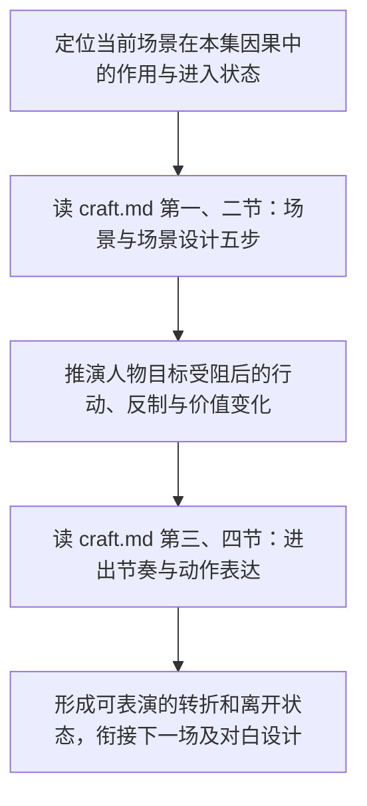

# 场景与段落｜专业资料导航

## 适用、原理与操作路径

- **适用情境**：首次设计承重场景的目标、行动、反制与转折；修订仅交代信息、缺少状态变化的场景。
- **专业原理**：场景变化来自目标受阻后的策略调整与价值转向。
- **注意与边界**：不必固定换十二个地点、列全部道具和拍摄镜头；导演镜头另行负责。

## 当前场景设计的执行路径

用正文方法推演当前场景的行动与状态变化。道具、悬念或空间承担关键作用时，选读第五至八节及相应案例，将其落实为具体攻防。

## 专业资料适用情境

| 创作问题 | 相关技法资料 | 对应理论、案例或工具 |
| --- | --- | --- |
| 场景只是交代信息、没有行动和变化 | [craft.md](craft.md)「场景目标／阻碍／价值转折」 | [scene-analysis-casebook.md](examples/scene-analysis-casebook.md)「麦基分析范例」 |
| 场景内反制乏力、道具与悬念无戏 | [craft.md](craft.md)「悬念、节奏、道具、进出场」 | [scene-analysis-casebook.md](examples/scene-analysis-casebook.md) 对应范例 |
| 要把人物意图写成可表演动作 | [craft.md](craft.md)「动作、场景铺排」 | 对白问题可进入 dialogue/index.md |

## 模块文件与用途

| 文件 | 用途 / 调用时机 |
| --- | --- |
| [craft.md](craft.md) | 本模块完整专业技法和原理；包含对应创作问题的完整论证与具体技法。 |
| [scene-analysis-casebook.md](examples/scene-analysis-casebook.md) | 实际作品/分析范例 |

## 使用边界

- 剧本、用户锁定事实及组织产物契约优先于历史教材中的页码、幕数、步骤、字数等标准。
- 索引定位适用技法、理论、案例及模板；正文承载专业知识，局部返修针对实际发生的问题。
- `examples/` 是实际作品与手法分析，`templates/` 是用于结构化整理的分析工具。
