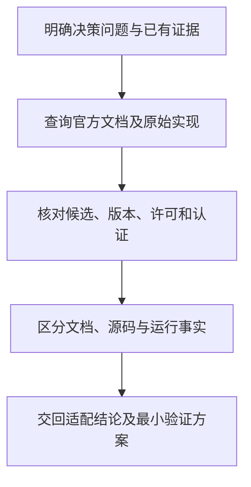

# Engineering Research · 技术调研

## 触发
只有存在明确的技术未知、技术选型、开源复用机会或外部兼容性疑问时开启。已核实的仓库事实和不受影响的结论直接复用。研究员负责给证据，不替技术负责人拍板、不擅自安装依赖。

## 调研流程

写清**决策问题**、本项目已知约束、评估时点、候选类型及可接受的最小实现；先检查仓库实际代码与当前项目契约。

优先查询官方文档、GitHub 原仓库和 Releases，再看高质量 Issues/PR。比较本项目已有依赖与实现，避免一上来就搜索第三方轮子。

对每个候选确认：具体解决的问题、代码或文档位置、最近维护情况（有日期）、许可证、运行语言及依赖、目标平台与部署环境、认证方式，以及与目标工程现有模块和数据契约的衔接。只评估会影响当前选择的维度。

必须区分：公开宣称/文档示例、代码中实际存在的功能、在本机真实跑通的功能。无法访问或未测试则标“未验证”，绝不编造 star、release 日期、性能数字。

评估官方 SDK/MCP、开源库、直接实现三条路线及迁移/维护成本。检查是否要求 API Key、付费凭证、隐式调用第三方服务；不假设可用 ChatGPT Auth 代替 API Key。

输出排序建议，最多 3 个主要候选。对比维度见 [开源方案评估矩阵](references/evaluation.md)。严重风险单独报告，给负责人明确的下一步 PoC 而非无限检索。

## 交付
研究结论必须包含问题、搜索时间、候选项目原始 GitHub URL、对应版本/提交或日期（可得时）、许可证证据、适配结论、引用出处、待验证事项和最小 PoC 方案。标注 `推荐/备选/不建议`，最终采用权在技术负责人。

参考：GitHub awesome-copilot 的技能发现方法、Agent Skills 的结构规范；本技能内容为独立撰写。
