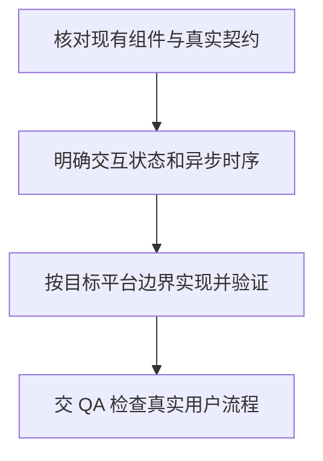

# Frontend Development · 前端开发

## UI 开发

读取工程说明、现有页面和组件、设计规范、依赖与构建配置，确认目标平台、语言、框架、路由及状态管理方式。沿用已有实现和工具；框架选择由工程事实和已采用方案决定。

先确认用户路径、加载中/空状态/失败状态/权限不允许状态及键盘可用性。接入后端时按真实 API 定义和事件时序处理断线、重连及旧数据。

明确请求发出与服务端确认的区别，不能只因按钮已点击就提示“任务完成”。

按目标平台的实际边界接入能力：Web 核对浏览器及网络约束；桌面或移动端核对原生桥接、设备权限和生命周期。只处理本项目实际涉及的分支，不把某个平台的能力当作其他平台也已验证。

按改动影响执行已有组件或集成检查，再由 QA 在真实可用环境验证必要的用户流程。沿用项目测试工具，未提供真实浏览器、设备或桌面环境时明确未验证范围。

## 输出
UI 变更点、交互截图/录屏（如果实际生成）、可复现测试步骤、状态处理记录、运行结果、待验功能。不得伪称浏览器操作已发生。

参考：GitHub awesome-copilot 的 webapp-testing 与微软 Playwright 实践，方法按目标工程的工具与平台采用。
