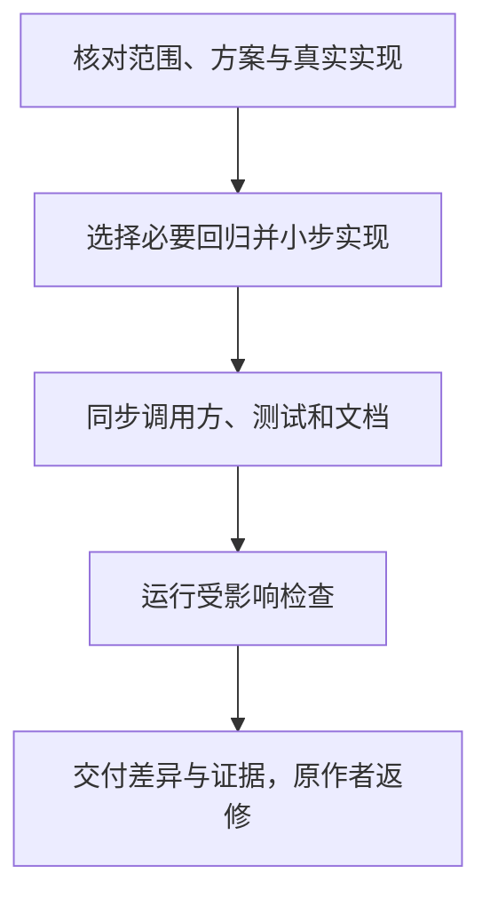

# Implementation Delivery · 功能实施

确认允许修改的仓库、分支/Worktree、任务范围、相关设计/接口、现有测试命令和禁止触碰项。

先定位仓库真实实现和依赖方向；未确认的接口不得凭经验凭空构造。发现方案冲突时提出具体变更请求，不擅自替换上游契约。

按改动的实际影响选择必要验证；故障修复优先用回归用例复现原问题，再小步实现和验证。可逆、低影响改动不为凑数量增加测试，难以隔离的部分说明未覆盖范围。

聚焦本任务的必要文件，按目标工程已确认的接口、数据及版本支持约定同步调用方、实现、测试与文档，清理已退役且无消费者的入口；是否保留兼容行为以实际工程要求为准。涉及并发、会话、后台任务或外部调用时核对相应状态、幂等、取消、恢复与权限，敏感凭据不写日志。

执行本任务关联测试、lint/typecheck/build 中实际可用的命令；输出退出码和关键日志位置，绝不捏造通过结论。

交付 changed files、commit 或 diff 范围、测试证据、设计偏差、待复核问题。原作者负责修复 QA/Code Review 发现的具体缺陷。

## 边界
按当前目标与已有授权执行。正式运行目录、运行中的应用或服务、远程推送与发布、全仓依赖升级及环境配置涉及范围变化时交负责人确认；授权已经覆盖的动作不重复申请。

参考：obra/superpowers 的 TDD 和 verification-before-completion（方法独立整理）。
