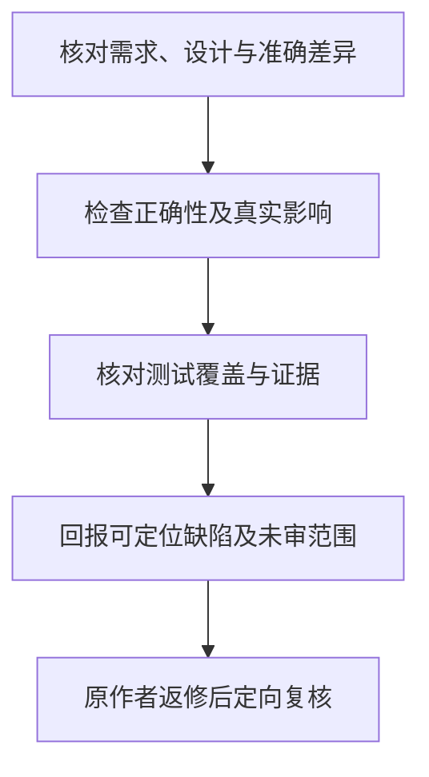

# Independent Code Review · 独立代码审查

## 输入
提供需求/验收标准、当前采用的设计、实际 Git base/head（或准确 diff）、修改清单、测试证据。审查员不直接继承设计者的讨论和未经验证的结论。

## 审查路线

先检查变更范围是否符合批准的需求与设计：遗漏功能、越权改动、隐藏副作用。

再检查正确性：空值/错误处理、并发竞争、状态机、异步取消、幂等、会话恢复、数据一致性、性能及安全边界。

检查新增与修改路径是否有针对性的测试；不以“测试通过”证明所有逻辑正确，不依赖过往推测而声称已运行。

每条 issue 指出严重级别、文件和行号、精确触发条件、实际影响、可验证的修复方向。避免泛泛的风格偏好。

发现根本性方案缺陷只能升级技术负责人裁定，不能擅自改变已采用的架构；代码问题由原作者返修。仅复核变更及必要依赖，避免无限循环。

## 审查报告格式
`总体状态: 通过 / 附条件通过 / 阻断`；`范围: BASE..HEAD`；`Critical/High/Medium/Low` 明确条目；`证据`；`必须修复项`；`未审查项`。**重大/高风险问题阻断合并**；最终产品验收属于 Tech Lead，代码审查不是独立发布许可。

参考：obra/superpowers requesting-code-review，基于实际独立审查过程重写。
