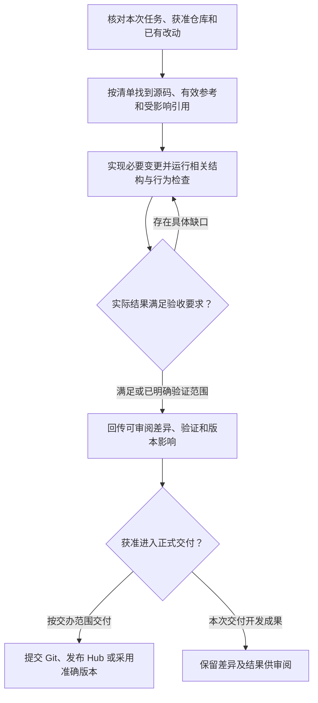

# 组织资源开发

以当前任务给出的 Git 仓库和目标资源为准。阅读仓库内的 AGENTS.md 和维护说明（若有），用 Git 核对当前分支、基线及已有改动。开发直接使用获准的工作树。通过清单定位文件和关联引用，保留任务范围之外的改动。

| 开发对象 | 源码入口 | 选择的方法 |
| --- | --- | --- |
| 组织 | `resources/packs/<id>/pack.yaml` | `workbench-resource-authoring` 的 `references/organization.md`，核对岗位、工作手册、员工和插件引用 |
| 员工 | `resources/employees/<id>.yaml` | `workbench-resource-authoring` 的 `references/employee.md`，按清单读取身份、个人方法和技能引用 |
| 技能 | `resources/extensions/skills/<id>/SKILL.md` | `workbench-skill-creator` 的包格式和校验要求，以及 `workbench-resource-authoring` 的 `references/skill.md` |
| 插件 | `resources/extensions/plugins/<id>/plugin.yaml` | `workbench-plugin-creator` 的包格式、连接和运行验证方法，核对同包命令、页面和配套技能 |

相邻类型的规则分别写入其所属资源。官方依赖按现有正式身份和版本引用，制作个人派生资源时记录来源与准确版本，采用可独立发布的 ID。检查结构、引用和行为所需的资料，以实际仓库、包和可用连接为准。发布并更新本机技能后，用正常任务验证实际效果，记录任务和使用版本。

正式交付以明确的文件和 Git 提交为依据。GitHub 远端操作读取组织已启用插件的工作流，Hub 版本采用按 `workbench-hub` 处理。回传实际变更、检查结果、未验证范围及本次交付达到的状态。
