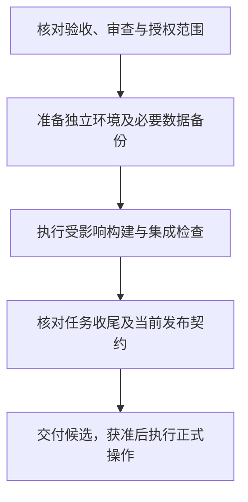

# Release Validation · 发布与集成

## 发布前核对

收集获准的分支、变更范围、负责人验收记录、QA 结果和必要的独立 Code Review 结论。

确认目标平台、交付物及环境，例如应用包、服务、容器镜像或库版本；沿用项目实际脚本、部署约定与独立测试数据。涉及持久数据升级时，按实际存储方案先备份，在副本或测试环境转换并核对数据与完整性，再按授权切换；保留项目要求保全的用户数据、配置与账号资料。

按变更范围选择项目现有的类型检查、测试、构建和打包脚本；仅在依赖需要时按 lockfile 安装。记录实际命令、环境及退出状态，明确未验证范围，不因存在脚本就运行全部流程。

按项目实际模块检查发布契约：存在前后端、客户端与服务端或公共库消费者时核对其衔接及版本支持要求；存在活跃请求、会话或后台任务时验证升级期间的收尾与恢复。单体或纯库项目不预设额外服务，不用未经验证的候选覆盖正式运行环境。

有重大错误或高风险审查缺陷时**停止发布**；回滚步骤先写清，实际操作按已有授权执行，缺少授权时交负责人处理。

## 操作权限
构建本地测试包可按既有授权；合并主分支、push、GitHub PR 对外提交、覆盖正式安装、更新自动启动服务或发布制品按当前工具权限和用户具体授权执行。用户批准并不授权删除旧数据。

## 输出
发布候选版本/commit、构建文件真实路径与校验信息、验证证据、风险和回退方案、是否获准上线及实际执行回执。未实施发布时只称“候选就绪”。

参考：obra/superpowers finishing-a-development-branch 和 verification-before-completion。
