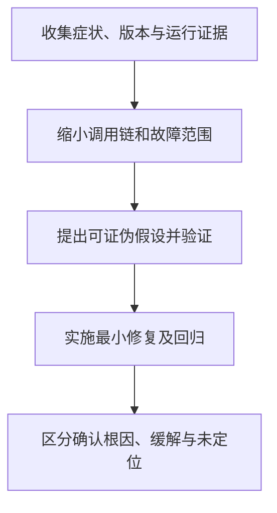

# Systematic Debugging · 系统化故障排查

遵循**先证据、后假设、再修复**。不以“看起来可能是”作为修复依据。

**重现和观察**：记录用户可见症状、环境、时间点、最近变更、日志、错误堆栈、输入/输出及复现概率；若不能复现，标出证据缺口。

**缩小范围**：用二分定位、调用链、日志与对照场景定位异常的最小边界，逐个排除并发、权限、网络、缓存等因素。

**验证根因**：给出可被证伪的假设，设计最小试验；不能只靠改代码后问题暂时消失来反推根因。

**修复及防回归**：原作者或获授权的开发人员写用例、实施最小修复，验证原症状和相关回归；记录系统性预防措施。

出现持续性环境问题时，明确“尚未定位/仅缓解/确认根因”三种结论。

## 高风险注意
排查应用、进程或服务故障时保留原始数据和诊断证据，不擅自清空存储、删除运行记录或重放可能有副作用的操作；收集诊断材料遵守当前授权与隐私边界。

参考：obra/superpowers `systematic-debugging` 四阶段方法，经本项目独立整理。
