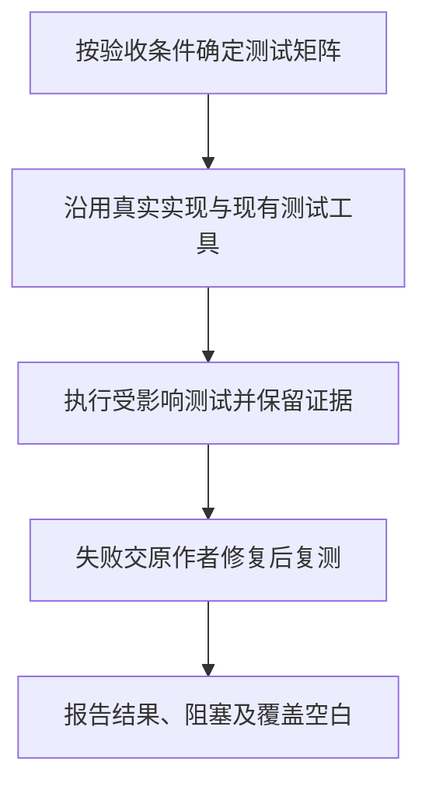

# Test Engineering · 软件测试

## 先判断测试范围
从已采用的需求和风险等级提炼正常路径、异常路径、边界条件、并发状态、数据迁移、授权拒绝/取消/重试以及回退测试；可按 [质量验证矩阵](references/test-matrix.md) 填写。

## 执行方法

查阅工程说明、构建与依赖配置、现有测试命令、框架及夹具。沿用项目实际语言和工具，按当前问题读取相关实现；不预设包管理器、平台或测试框架。

新功能优先设计可失败的断言；Bug 至少有一个能复现原故障的回归测试。测试必须区分真实集成与模拟替身。

按由小到大的顺序执行单元、集成、关键链路、必要 UI/E2E，保留命令、环境、退出码、失败用例及关键输出。

测试失败提交最小复现/日志/期待值/实际值/定位线索给原作者；不为了通过而删除、跳过或削弱测试。遇到环境缺口标阻塞而非通过。

修复后重跑受影响用例及相关回归；声称全量通过前必须真实执行全量测试。

## 交付
测试矩阵、执行证据、失败列表、未覆盖范围、阻断性缺陷；测试工程师不能替代码审查员批准架构质量，也不能替负责人终验。

参考：obra/superpowers 的 test-driven-development、verification-before-completion；独立改写。
