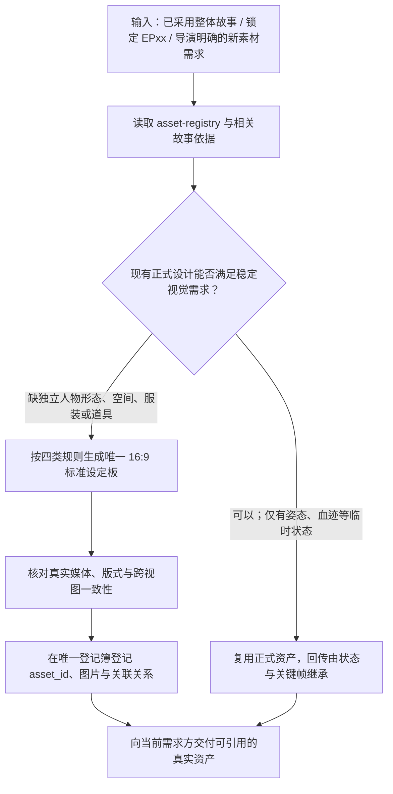

# 视觉设计与素材生产

用于全剧基础建库、已采用单集的素材补缺及导演提出的正式设计需求。正式素材锁定稳定设计，剧情中的临时状态由导演描述与按当前用途确认的实际状态依据承接。

先核对当前任务、已采用故事依据、现有 `asset-registry` 与真实媒体，再通过[视觉专业方法索引](references/index.md)选择本次需要的专业资料。正式/临时资产的判定以[资产原则](references/asset-principles.md)为准；成果按组织产物契约登记。

## 实际工作流

## 按需专业资料

完整导航以[视觉专业方法索引](references/index.md)为唯一入口：按素材提取、正式设计、四类出图、音色选择、Shot 匹配或登记契约选择相关方法，不必通读全部文档。方法中的步骤服务于本次实际专业问题，不额外设立组织产物或固定审核节点。

生成与引用以真实文件、已安装工具和当前权限为依据；图片和声音的适用性按实际查看、试听结果判断。
