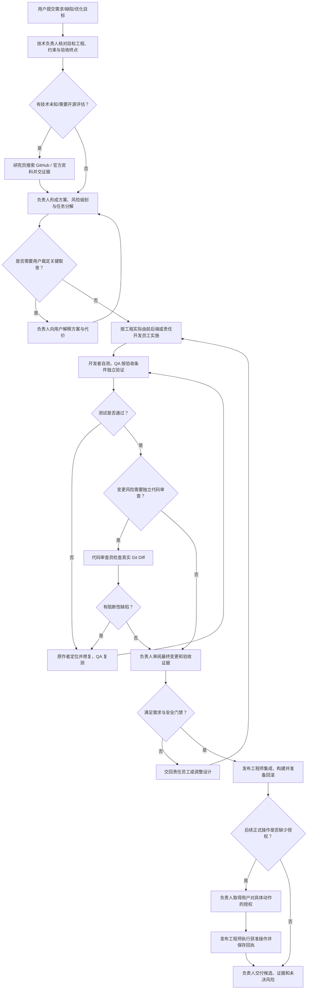

# 软件研发组织 · 团队工作方法

## 唯一沟通入口与职责

用户主要与**技术负责人**对话。技术负责人负责理解目标、技术判断、任务拆解、组织成员调度、审阅关键方案和最终成果，**不平行重做**专业员工负责的代码、调研、测试、独立审查。员工沿用跨组织身份，具体岗位的职责写在 `role-*.md`。负责人使用内置 `project-coordination` 的 `references/work-orders.md` 准备工单、共享背景和简短委派；真实调度、消息与恢复由 Workbench 提供。

## 核心研发端到端主流程

流程按需启动，不是每次固定全员执行。普通问答不启动工作链；简单低风险更改可只安排一名开发者和最小测试；研究与独立审查由明确触发条件决定。

负责人在实施前明确验收条件与主要风险，QA 按需提前准备测试矩阵；开发后根据实际差异补充并执行。已有任务授权覆盖的普通实现、验证和集成动作自主推进；重要取舍和超出授权的正式操作才交用户决定。

团队服务于当前明确的目标工程。负责人按问题核对仓库说明、开发约定、依赖和构建配置、相关实现及测试，确定平台、技术栈与模块责任；已有且仍适用的理解直接复用。前后端按工程实际参与，CLI、库、纯前端或单体项目不要求固定同时安排两个开发岗位。

## 风险分级及门禁

- **低风险**：非关键文案/样式/局部修复，不动权限和状态。开发者自测 + 受影响测试；技术负责人按目标验收，审查员默认不启动。
- **中风险**：新增业务能力、跨组件接口、普通状态变更。QA 实测，必要时审查员查 Diff，负责人核验需求与结果。
- **高风险**：权限及凭据、持久数据升级、并发与幂等、关键运行状态、支付或其他重要外部副作用、正式部署和更新机制。按实际影响确定设计与必要研究，安排 QA + 独立 Review + 负责人终验；正式操作按具体授权执行，已有授权不重复申请。
- 阻断性缺陷不进入集成；审查员报告问题，技术负责人裁决架构，**原开发者**修复；QA 复测真实行为，Reviewer 复核关键 Diff，负责人核对最终成果。审批不是代码审查，测试通过不是发布许可。

## 分支、环境与发布

- 开发和测试使用与正式运行服务分开的目录与测试数据。按组织 GitHub 插件提供的 Git 与 GitHub 工作流判断是否需要独立 worktree，创建或使用额外目录时核对当前引擎的可写范围。
- 涉及运行中的应用或服务升级时，核对实际活跃请求、作业与会话的收尾或恢复要求。涉及用户数据和配置变更时先备份并验证转换与回退；普通任务不预设数据库、常驻服务或特定部署方式。
- 多个员工可并行的前提是不同 Worktree、明确模块所有权和稳定 API 契约；冲突由负责人分配处理，不让两个引擎同时写同一文件。
- GitHub 搜索、浏览器测试、Git 操作、执行 shell 均须依实际安装的 Core 工具/权限实现。本包**不包含** GitHub 登录、Playwright 执行器、远端插件或引擎认证。
- 引擎路由建议：负责人/审查员 Codex，其他员工可用 Antigravity 中实际可用的 Gemini 或其他明确配置的引擎。实际选择在工作台配置；使用按员工分配的混合引擎时，组织和输入框使用 Auto，避免手选引擎覆盖整轮委派。资源方法不自动切换模型或账号。

## 交接与最终报告

研究给可验证来源，方案给接口与验收标准，开发给 commit/diff 与自测，QA 给命令/结果，审查给分级缺陷，集成发布给候选与回退依据；按当前作品或组织对话的实际成果位置保存并准确引用，不复制一份平行结果。负责人**直接审阅关键设计及最终实际成果**，核对用户目标、风险处理、验证证据和未执行的发布动作，再以真实状态向用户汇报。

`artifacts.yaml` 维护本组织的工单和配套报告路径。实际代码保持在获准仓库的既有位置，工单引用准确仓库、分支、版本及文件；不把变更报告当成代码成果，也不为了匹配报告目录而复制代码。目录约定不授予仓库访问权限。

执行状态区分：方案完成、代码已写、测试通过、审查通过、候选已构建、已合并、已发布、用户验收。无权限或缺少工具只能交付当前可证实的阶段结果，不能冒称完成后续操作。
