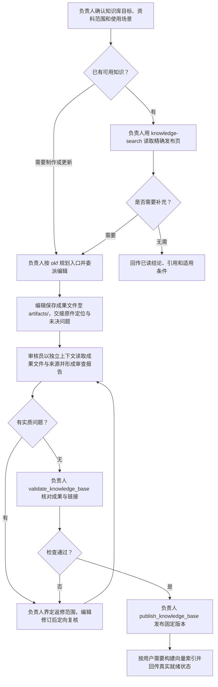

# 知识库制作组织

负责人接收目标、确定资料范围、安排编辑与独立审查，并维护入口和发布版本。编辑将获准原件整理为可追溯的概念、方法与来源说明；审核员检查准确性、来源覆盖、冲突、适用条件和导航，不替作者改写成果。普通查询由当前员工直接使用 knowledge-search，不必启动全组制作。

组织使用 `okf` 的编写、维护和审查方法；协作操作由负责人使用 `project-coordination`。`artifacts/` 目录下的 Markdown 页面作为知识库成果，原件在 attachments；审查报告的保存与回传遵循 `okf/references/review.md`，其他过程文件保留在当前任务 `work/outputs`。首次发布和实质更新都安排独立审查；这是组织工作方法，不把审查意见说成系统审批。被退回的内容明确问题和依赖，修订后重新核验。

跨组织使用由用户在知识库页面按具体库授权。消费方使用 knowledge-search 读取发布版本；权限不足由负责人说明所需授权，不扩展整个制作组织的资料权限。维护组织负责员工、技能、插件与连接的配置，制作组织负责知识内容。
