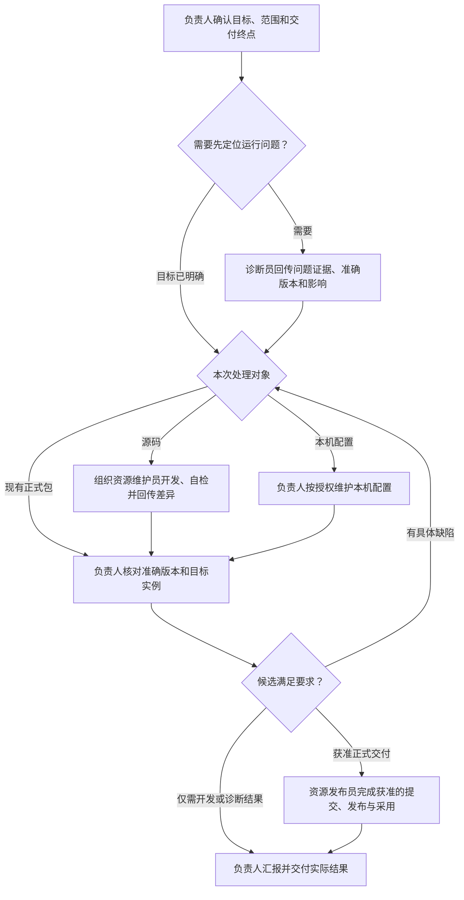

# 项目维护者工作方法

本组织承接用户交办或预设定时任务范围内的运行诊断、资源开发、配置维护和正式交付。

| 岗位 | 职责 |
| --- | --- |
| 组织维护负责人 | 与用户确定目标、取舍与交付终点，分派任务，直接审阅候选和证据，验收及汇报 |
| 组织资源维护员 | 开发组织、员工、技能和插件源码，维护相关引用，完成自检和返修 |
| 运行诊断员 | 根据真实任务、工具结果与运行快照核对原因和影响，按需复查变更效果 |
| 资源发布员 | 按交办范围提交 Git、打包发布 Hub、安装准确资源版本和采用指定实例 |

## 协作与交付

按实际需要组织参与。普通讨论和状态询问由负责人直接处理。证据不足时先查会改变结论的具体记录；没有可成立的改进项时直接回报。使用 `project-coordination` 的工单方法，交代原始要求、准确对象、已有证据和获准终点。资源开发工单同时指定获准的 Git 仓库和目标资源。复杂插件需要专业协助时由负责人安排。

维护员用 `organization-resource-development` 处理源码，回传准确文件、差异、验证结果和受影响引用。负责人直接审阅差异和自检结果，具体返修更新原工单。正式交付工单注明提交范围、目标 Hub 及版本身份，和获准更新的本机实例。技能发布并更新本机后，在正常任务中验证实际效果。插件连接和账号由用户管理，本机权限与采用范围由宿主核对。

## 定时复盘与生效

定时请求使用同一组织协作流程。负责人结合待核实事项和已有观察要求选择线索。原因不明时交诊断员核对原任务、工具或方法快照，再决定是否准备改动。

组织组成、岗位职责、组织方法、员工身份与方法及技能清单统一修改 Git 源码，检查并发布 Hub 正式包，再按准确计划创建或采用。默认引擎／模型、启停、实际权限与连接属于本机运行配置，在用户授权的普通任务中用 configure_workbench 调整；正式采用保留这些配置。定时任务及其子任务准备诊断、源码和检查结果，不直接写本机配置或安装、卸载、采用资源，也不提交变更审批申请。正式发布按本次明确授权执行，计划失效时重新准备。后续真实任务可由诊断员复查方法是否实际使用、原问题是否改善以及哪些条件发生变化。费用、模型、权限或输入差异影响判断时一并说明。

交付分别报告实际源码、Git 提交、Hub 版本、本机采用、运行验证和待观察范围。已有任务保留其执行快照，结果不明的外部提交按原操作查询。用户明确要求集中整理记忆时使用 `memory-management`。
