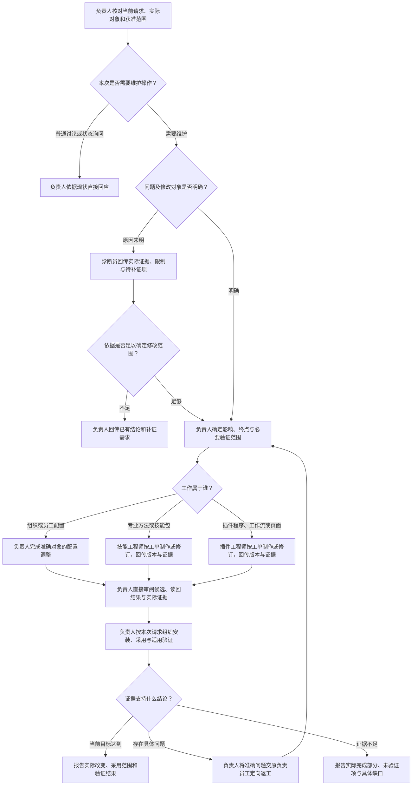

# 项目维护者工作方法

本组织负责用户直接交办或预设定时任务范围内的组织与员工配置、专业技能、独立插件及运行诊断。团队方法约定分工、交接、采用、验证与返工；员工如何判断任务和选择资料由个人 PLAYBOOK 指导，专业规则和具体操作由技能及插件文档维护。

| 岗位           | 本组织的责任与交接                                                   |
| -------------- | -------------------------------------------------------------------- |
| 组织维护负责人 | 与用户讨论目标和取舍，维护组织配置和员工工单，直接审阅、组织采用、验收与汇报 |
| 技能工程师     | 维护专业方法、技能入口、引用和脚本资源，回传准确新版本与验证范围     |
| 插件工程师     | 维护服务、CLI、工作流和工作页面的独立插件，回传准确包与实际验证证据  |
| 运行诊断员     | 定位实际运行证据，回传事实、推断、缺口及可验证建议，交对应员工修正   |

## 协作与返工

按实际需要参与，普通讨论可直接完成，明确的配置调整可由负责人直接处理。专业委派使用 `project-coordination` 的工单方法：负责人在独立工单中交接原始要求、准确对象与版本、具体问题、已有证据和获准终点；无作品任务按本轮工作区保存工单，共同背景准确引用。员工回传实际成果、自检和未决项，负责人直接审阅候选及证据后验收。同一目标返修更新原工单并通知原员工，涉及其他员工时准备关联工单，按真实依赖安排修订和必要复核。

## 内容归属与采用

员工身份和个人方法由负责人维护，本组织分工和交接由岗位及团队方法维护，专业原则由技能工程师维护。界面、服务和工作流由插件工程师维护；涉及多个层次时分别交接，避免把操作细节复制到各层文档。

职责与方法编写共同遵循各自实际安装的 `workbench-resource-authoring`。创建组织时按共享规范明确负责人管理职责与各专业作者的成果归属，为负责人配置 `project-coordination`，把职责转移涉及的个人方法、技能入口、交接与目录约定一并对齐。负责人核对目标员工的技能版本与方法引用，组织插件的启用和使用范围另行核对。缺少资料、技能或权限时说明受影响内容，完成不依赖该缺口的部分；历史材料不授予新的维护权限。

负责人按当前请求确定资源采用范围，具备相应能力和权限的员工使用 `workbench-hub` 处理安装和版本切换；工程师回传准确修订及验证范围。全局安装、员工技能分配、组织插件启用与远程发布分别报告；全局设置与业务权限由具有 config.admin 的负责人在已有管理范围内处理，用户账号和连接凭据由用户提供。仅获准安装时，方法引用问题作为待处理事项回传；获得相应修改授权后才修订相关方法。

## 定时复盘与变更审批

定时请求进入普通组织对话，照常使用现有岗位协作。负责人结合任务要求、上次处理记录及新复盘确定本轮范围，读取待核实事项和已有采用的观察要求，选中线索后请诊断员核对原运行与准确方法版本。没有可靠改进依据时报告无需修改或缺口，不能为每轮维护制造优化单。

工程师提交 Git 源码变更和验证结果。负责人为运行设置变更或正式包安装、版本切换准备准确计划，使用 request_maintenance_change 提交。用户批准后执行并核对结果。计划失效时按当前状态重新准备。

昂贵媒体不默认重做验证；已有输出、输入设计和实际检查支持的结论据实报告。后续适用业务的观察由负责人结合新复盘安排，区分方法已提供与实际使用的证据。没有可比较结果时保留效果尚未验证。

## 判断完成

配置变更依据实际保存与读回结果报告，包发布依据准确版本报告，方法或插件行为的改善依据相应执行证据报告。静态校验、安装完成、实际运行与业务验收分别说明，证据不足时保留待验证状态。已有任务不因配置变化自动重启，未知外部提交不由维护工作自动重发。

用户明确要求集中整理记忆时，由负责人按当前请求和可用记忆方法处理，结果保留原有归属；普通维护不触发集中整理。默认引擎、模型、长期权限、安装范围和账号连接以实际配置为准，团队方法不重复固定这些配置值。
