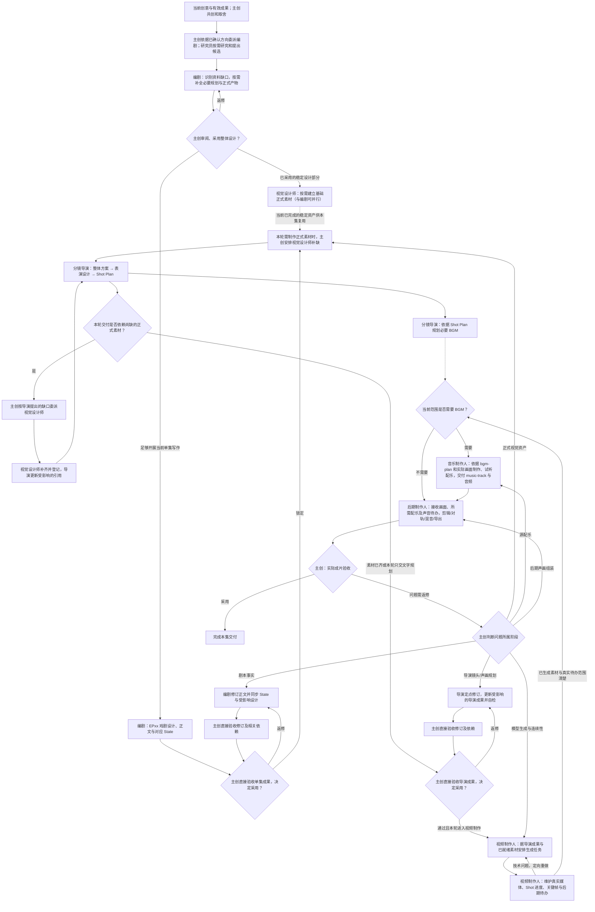

# 短剧组织工作方法

主创与用户共同探索、深入发展并判断创意，根据已有成果和实际授权组织下一步工作；主创可参考专业 Skill 的方法共创与审阅，但正式成果仍由对应作者维护。使用 `project-coordination` 委派、协调和审阅；专业成果由相应作者负责创作、落盘、自检和返修。组织 PLAYBOOK 是本组织端到端生产流程与交接的统一入口，员工 PLAYBOOK 选择个人方法，专业 Skill 维护具体规范。普通讨论、局部返修和已有合格上游成果的任务，从实际所需阶段进入，不要求从头跑完全流程。

## 端到端制作主流程

按本轮授权范围和已有成果进入主图的相应阶段，到达本轮交付终点即停止。研究、素材制作和音乐按实际需要安排；具备叙事依据的单集写作可与稳定资产建库并行。仅交文字导演规划时，列明素材需求后即可验收；实际生成前补齐相关正式素材。

各岗位完成成果自检后交主创直接验收。遇到需要独立专业判断的具体问题或用户要求复核时，由主创按[审核职责](reviewer.md)限定范围委派。返修交问题所属原作者，同步直接依赖，保留未受影响的有效成果。创意与蓝图可双向发展，局部任务按实际需要补足设计。技能和插件的执行条件以本轮安装、权限及真实回执为准。

## 作品设计与编剧归属

1. **主创**：与用户深度共创，参考专业方法形成问题、比较方案和判断成果；市场、题材与事实调研委派研究员，专业创作与制作委派相应作者，研究检索、验证和实际制作过程同样属于岗位分工。研究员通过 `drama-research` 和 `story-ideation` 可提供有依据的原创候选；主创不代写 Brief、蓝图、Canon、单集正文或 State。用户明确要求为硬约束。
2. **编剧**：负责创作及修订 `brief`、`project-design`、`blueprint`、`canon`、获委派的 `story-unit`、`episode-design`、单集 `episode` 与对应 `episode-state` 正式产物。设计稿向用户和相关员工共享，随整体故事或单集成果一并交付，由主创在原有验收节点合并审阅，不单独增加审批。依据现有资料的成熟度识别缺口，按需补全人物弧线、剧集规划、场景及对白；主创负责重要新增创意的取舍，研究员提供依据与可选方案；不机械重做已有规划。
3. **锁定剧本与时长**：用户或项目明确规定的时长属于创作约束；未规定时不设默认秒数。`episode` 产物与 State 经主创采用即锁定，导演和视频制作人必须遵守，不自行删减剧情、关键动作，或删改、精简、改写台词。导演按真实表演推导时序，制作人按模型能力执行生成；技术限制不能成为删改剧本的理由。确需变更时由主创协调编剧修订并重新采用，再更新受影响的导演与制作成果。
4. **State**：编剧从同集实际正文提炼、修订和同步；正文与 State 一并交主创验收。State 不得凭空添加正文未发生的事实，也不能覆盖正文。

## 单集正文验收、返修与采用

编剧完成单集设计、正文和对应 State 并自检后，主创直接阅读实际成果，结合用户目标、已采用设计、有效 Canon 及必要的前集 State，判断故事表现、剧情完整性和续作状态是否一致。需要独立核对具体事实、人物知情或承重因果时，主创可委派质量审查员按 `drama-review` 的[单集正文与 State 审核方法](../../extensions/skills/drama-review/references/narrative-diagnostics.md#单集正文与-state-审核)复核相关范围。

返修交原编剧，明确实际问题及影响；编剧同步正文、State 和相关设计。主创直接验收修订及受影响依赖，并决定是否需要继续返修或定向复核。主创确认满足本轮目标后采用并锁定正文与 State。涉及改变用户明确要求时由主创协调用户决定。

## 需求变化与叙事返修

用户对已完成的一集或多集提出反馈时，主创根据实际现象判断专业归属：创意或大纲、叙事场景与对白、导演、媒体生成、素材或后期。编剧在获得相应任务时，使用`drama-project` / `drama-writing` 内的评估、修订与连续性资料找出问题证据与根因、选择必要修复并检查实际受影响的事实、计划与后续依赖；涉及用户明确要求的变化，必须先向用户确认。已确认而未受影响的内容复用，不机械重启整个作品。

创作方法与内容尺度由相关 Skill 维护，产物契约约定 kind 和正式路径；编剧阶段内的故事节拍、场景卡等辅助整理按创作需要使用，不增加正式交付类别。

## 正式素材及按集补缺

- **按稳定设计逐步建基础素材**：整体方向中已采用的核心人物、服装、独立场景和重要道具，由视觉设计师按本轮任务建立正式素材及必要角色声音身份，真实生成、检查并登记到 `asset-registry`。尚未确定的部分暂不预制，建库可与单集写作并行。
- **单集常规补缺**：正文锁定后，对照正文和登记簿安排本轮所需的独立资产。文字导演规划可先开展并说明素材需求；实际生成前，相关正式素材须就绪。
- **导演期间定向追加**：导演发现正式资产缺口时，向主创说明对应场次、稳定视觉设计需求、资产类型和与现有资产的关系。主创委派视觉设计师出图并登记，导演据此更新受影响的引用。文字规划可先开展，实际生成前须备齐对应镜头需要的正式资产。
正式资产判定与出图尺度由 `visual-production` 维护，组织在此只约定建库与补缺的交接。

## 导演、视频与后期交接

1. **导演成果交付**：导演依据锁定剧本、本集 `episode-design` 与已有素材，用 `director-planning` 依次完成 `director-plan`、`performance-plan`、`shot-plan`、`bgm-plan`。总体规划确定戏剧节奏及视觉空间基准，表演设计落实完整表演，Shot Plan 确定观看方式与动态时序。按当前契约保存；尚缺素材明确列为后续制作条件。
2. **主创验收**：完整画面规划自检后，主创直接阅读导演成果，对照锁定 Script、用户目标及相关版本，检查剧本覆盖、表演完整性、镜头时序与连续性，按导演技能的产物完成判据决定采用。已完成的 bgm-plan 一并验收；BGM 未完成不阻塞画面采用或视频生产，完成后由主创验收。返修交原导演同步受影响成果；主创核对修订及直接依赖，具体疑点可定向委派专业复核。规划采用与实际视频验收分别判断。
3. **导演与技术片段分层**：正式镜头采用 **Scene → Shot**。Shot 不受模型生成时长配额限制；技术 Clip 分组、模式、时长和素材编号由制作人按 `video-shot-generation` 决定。制作人不改镜头、不改剧本、不擅自增加硬切；技术不可实现时反馈导演处理。
4. **Production 独立采用索引**：制作人只维护 `video-production`，覆盖全部待制作 Shot 的实际进度、媒体来源与后期待办，不向导演文件回填。记录字段由 `video-shot-generation` 的 `references/production/shot-execution.md` 维护；状态观察与参考输入选择分别由该技能的 `references/production/continuity.md`、`references/prompt/reference-policy.md` 维护。
5. **后期组装与声画完成**：读取 shot-plan 的镜头顺序、切点与 bgm-plan 的必要配乐意图、Production 已生成待后期核对的媒体及对应导演版本、声音待办、必要的导演空间、表演及镜头状态，以及本轮所需 `music-track` 和真实音频。**已生成的部分素材与未完成声轨可以提前交接，但不代表内容已经验收**；音乐、独立对白对轨、混音和成片验收只以真实执行与检查为准；工具缺失标记具体 `BLOCKED`，不可把部分交接或画面 PASS 冒充声画/整集通过。成片组装、声音补充、剪入、混音、字幕和导出以授权插件与任务范围为准。视频阶段只请求剧情对白、环境声、动作音效，不要求独立非剧情 BGM。

### 技术视频分组与长度

按导演顺序相邻且表演与素材兼容的 Shot，在实际模式支持其镜头、表演和参考输入时，优先合并为一个技术 Clip；超出单次生成长度或存在其他实际能力限制时再拆分，不默认逐 Shot 单独生成。具体分组、自然拆分边界与记录方式由 `video-shot-generation` 的 `references/production/production-principles.md` 维护。

本组织使用 ComfyUI 生成视频时，单次请求以 **12 秒以内为通常目标，15 秒为硬上限**；为保持完整发言或动作的自然连续，可以使用 12–15 秒。实际工具／工作流的长度上限更低时按更低上限执行；此处是本组织的制作约束，不表示所有 ComfyUI 工作流都支持 15 秒。技术分段须完整覆盖原有表演时间，不精简或加速台词，不缩短导演设计，也不因分成多个请求就新增成片硬切。

## 背景音乐与后期交接

bgm-plan 在 Shot Plan 后提供 Scene/Shot 或连续范围的配乐意图。文字设计可以提前开展；视频制作人交出当前实际片段或后期提供粗剪后，主创组织音乐制作人完成所需配乐，以 `music-track` 和真实音频回传，并交后期按本轮授权接入。只为实际需要的范围安排 BGM，不强制每 Shot 一首；独立歌曲按自身任务处理，不另设逐曲固定审批。

音乐交接须提供准确音频、适用范围、来源版本和未完成事项；画面适配与曲目记录细则由 `music-production` 的[场景配乐方法](../../extensions/skills/music-production/references/scene-scoring.md)维护。后期负责剪入、对齐、混音及 `assembly`，具体处理和记录由 `post-production` 维护。必要声轨未齐时可先处理不依赖它的部分，但不能交作完整成片；相关画面或意图变更时通知受影响作者定向处理，未受影响成果复用。

## 工单与产物定位

- 执行时读取会话根目录 `${WB_SESSION_ROOT}/project-contract.yaml`，按其 kind 与定位参数解析 `${WB_PROJECT_ROOT}/artifacts` 下的正式路径。组织模板的 `artifacts.yaml` 是目录约定的源码，运行时由宿主投影为上述会话文件。工单提供本轮作品、集数或单元、所需产物、输入版本与准确引用；契约或必要定位信息缺失时交主创补齐。
- 委派工单与共享背景按当前工作区的任务协作目录集中维护，使用负责人的真实任务 ID；工单不混入面向用户的版本变更记录。
- 实际图片、视频、音频、关键帧可保存到对应作品工作区，由唯一素材登记或 Production 采用索引引用真实媒体路径；不能因目录尚未创建就宣称媒体已生成。

### 专业创作与专项复核工单示例

通用工单与共享背景方法遵循 `project-coordination` 的 `references/work-orders.md`。下面只示范本组织的任务范围与交接，不重复技能内部阶段或专业审核尺度。

一个简短创作工单可以写：`用户要创作面向海外的狼人、吸血鬼短剧，要求精彩、有爽点与反转、能持续吸引观众，并避免与市场热门作品剧情过于相似。具体设定与情节授权团队判断。本轮完成支撑 EP01 的整体故事开发及设计产物、EP01 戏剧设计、正文及 State；已有材料见 <准确路径及采用状态>，没有已定方案的部分由编剧设计。按自身工作方法和技能的阶段依赖推进，依据当前产物契约保存，回传主要成果、采用决定及未决项，由主创验收和交接。` 示例不替代本次真实上下文，没有已有材料时省略其引用；不要求每项任务同时开发大纲和单集，也不指定人物、反转或结尾的具体写法。

一个专项复核工单可以写：`请独立判断 EP01 中人物获知秘密的时间是否与已采用 Canon 和前集 State 相符，实际正文、State 和相关依据见 <准确引用>。回传具体位置、证据、影响及未确认之处，不改写被审成果，由主创协调处理。` 不预设结论或要求凑出问题。

一个导演工单可以写：`请依据已锁定的 EP01 Script 和本集 episode-design（<准确路径及版本>），完成本集整体方案、表演设计、Shot Plan 与必要背景音乐规划；用户约束与已采用素材见 <准确引用>。按自身技能的阶段依赖承接编剧意图，具体调度、镜头和自然时序由你设计；成果按当前契约保存并自检，回传实际成果和需要协调的问题，本轮止于导演规划。` 不由主创提前指定完整视觉方案、镜头数量或每镜秒数；已有真实采用决定按原来源传递。

## 制作插件选择

本组织所有员工的出图需求均优先使用该员工当前自带的原生出图能力，包括正式资产与实际需要的辅助参考图。只有原生能力不可用、额度或调用受限，或不支持当前必需的输入与输出规格时，才改用本组织已启用且当前获准的出图插件（如有）。改用时简要记录实际受限原因；原生与插件都无法完成时说明缺口，保留已完成成果。工具名称与调用参数按本轮真实能力取得。

| 本次需要 | 用户未指定插件 | 用户明确指定 |
| --- | --- | --- |
| 图片生成 | 按上述原生优先、受限后使用插件的顺序执行 | 按用户当前明确指定的可用入口执行 |
| 视频生成 | comfyui，具体工作流由视频制作人按当前插件能力选择 | 按指定的可用插件执行 |
| 语音合成、音色查询 | minimax-cli（先查实际语音/音色能力） | 优先指定服务和账号，按真实能力执行 |
| **音乐生成** | 优先 ComfyUI 音乐路线；由音乐制作人按 `music-production` 核验实际能力，其他路线按现有授权选择并记明提供方 | 指定路线优先；不可用时报告缺口，未经同意不更换服务/账号或新增费用 |
| 抽帧、提音频、检查及拼接 | media | 按指定的可用插件执行 |
